# Speech Runtime

**Один локальный сервис для речевых моделей: общий каталог моделей, единый API, любое число приложений.**

Идея та же, что у Ollama для LLM: модель скачивается один раз, живёт в одном месте, загружается по требованию и переиспользуется всеми клиентами. Приложения больше не тащат в себя веса, движки и логику загрузки — они просто просят распознать речь.

> **Статус: исследование завершено, идёт архитектурная валидация.** Runtime не реализован. В репозитории — технический отчёт, 26 отчётов субагентов и зафиксированные решения по архитектуре.
>
> **Добавлено 2026-10-26 (этап валидации):** офлайн-стенд оценки `experiments/asr_eval/` — нормализатор `norm-v1`, словарь терминов, скорер WER/CER и терминов, парный bootstrap, валидатор набора (шаги 0–1 из [V8 §10](research/wave2/V8-eval-plan.md#10-порядок-работ-пошаговый-план)) и публичный dev-sample русской IT-речи `experiments/corpus/`. Это инструменты измерения, а не сервис: ASR-модели на них ещё не прогонялись, чисел качества моделей нет. Подробности — [`experiments/asr_eval/README.md`](experiments/asr_eval/README.md) и [`experiments/corpus/README.md`](experiments/corpus/README.md).

---

## Главный вывод

**Строить собственный сервис на Swift, а не форкать готовый проект.** Демон `speechd` управляет моделями и сессиями, модели исполняются в отдельных процессах-воркерах по семействам движков: ONNX (sherpa-onnx), CoreML (FluidAudio, WhisperKit), MLX (библиотеки speech-swift). Готовые проекты подключаются как библиотеки движков; их серверы — как источник проверенных решений.

Почему не форк:

| Кандидат | Что мешает |
|---|---|
| **speech-swift** | Один инференс на процесс (`InferenceGate`, 1 слот), модели не выгружаются никогда, ASR не потоковый, маршрутов VAD/диаризации/эмбеддингов нет, аутентификации нет. Сервер не является библиотечным продуктом SPM — «подключить как библиотеку» нельзя |
| **SpeechRail** | Одна активная модель на машину, batch XOR streaming, только Qwen3, Python |
| **speaches** | Заброшен с апреля 2026, только batch |
| **WhisperLiveKit** | Одна модель на процесс, `model` в запросе игнорируется |
| **gotranscribesrv** | GPL-3.0, биллинговый шлюз, русского языка в стеке нет |

Почему процессы: MLX при ошибке завершает процесс целиком (`fatalError`), две CoreML-модели, вызванные параллельно в одном процессе, падают с `EXC_BAD_ACCESS`. Убить процесс — единственный гарантированный способ вернуть память. Цена изоляции мала: воркер стоит 3–17 мс на старт и 6–18 МБ RSS.

Почему не Rust: выигрыш — около 4 МБ памяти на процесс, цена — второй тулчейн, вторая подпись и дублирование типов протокола. Связка `ort` + `sherpa-onnx` в Rust не линкуется (десятки `duplicate symbol`), а в Swift все нужные библиотеки собрались в один бинарь и запустились.

Почему TCP, а не только Unix-сокет: приложения из App Store (в sandbox) подключаются к `127.0.0.1` с одним разрешением `network.client`, а к сокету в `Application Support` — нет (`EPERM`). Unix-сокет остаётся оптимизацией для CLI и своих приложений.

Схема: [`docs/diagrams/architecture.html`](docs/diagrams/architecture.html)

---

## Что должен уметь runtime

1. Работать полностью локально после установки моделей.
2. Давать API независимым приложениям.
3. Поддерживать потоковое и пакетное распознавание.
4. Поддерживать VAD, диаризацию и голосовые эмбеддинги.
5. Иметь единый каталог моделей без повторного скачивания для каждого приложения.
6. Переиспользовать загруженные веса между клиентами.
7. Поддерживать одновременные независимые сессии.
8. Позволять явно выбирать модель и операцию в запросе.
9. Поддерживать несколько вычислительных движков через адаптеры.
10. Уметь устанавливать, удалять, обновлять и откатывать версии моделей.
11. Обслуживать Swift, Rust и других клиентов через стабильный локальный API.
12. Иметь минимальные накладные расходы в простое и при обработке речи.

**Чего runtime не делает:** не выбирает модель по смыслу запроса, не ведёт диалог, не вызывает LLM и инструменты, не работает голосовым ассистентом. Модель и операцию всегда называет клиент.

Примеры клиентов: ассистент для созвонов (потоковое распознавание + VAD), диктовка (распознавание законченных реплик), обработка встреч (пакетная транскрибация, диаризация, таймстемпы), голосовой помощник (получает текст и сам вызывает LLM).

---

## Структура репозитория

| Путь | Что внутри |
|---|---|
| [`docs/report.md`](docs/report.md) | **Итоговый отчёт**: сравнение проектов, архитектура, матрица моделей, план, риски, рекомендация |
| [`research/README.md`](research/README.md) | Метод исследования и индекс всех отчётов |
| [`research/wave1/`](research/wave1/) | 18 отчётов первой волны: готовые проекты, аудиты speech-swift и SpeechRail, модели, VAD/диаризация, Swift vs Rust, управление моделями, API, адаптация русского IT-языка, сообщество, лицензии |
| [`docs/diagrams/`](docs/diagrams/) | Схемы: `architecture` (демон и воркеры), `plan` (этапы). HTML — интерактивная версия, SVG — встраиваемая |
| [`research/wave2/`](research/wave2/) | Черновик архитектуры и 8 проверок: верификация по коду, поиск готовых реализаций, совместимость библиотек (с реальной сборкой), сравнение 5 архитектур с замерами, фактчек моделей, независимая критика, план проверки |

---

## Ключевые находки

- **Готового аналога «Ollama для речи» нет.** OWhisper с 289 баллами на HN удалён, speaches заморожен, остальные — сервер вокруг одного движка.
- **Нужные модели живут в трёх разных движках.** GigaAM v3 — практически только ONNX; Voxtral Realtime и Qwen3-ASR — MLX; Nemotron 3.5 с русским потоковым распознаванием и Nemotron-3-Diarization на нейроускорителе — CoreML.
- **Качество на русской IT-речи не измерено ни у одной модели.** Публичного датасета «русский + английские термины» нет — его придётся записывать.
- **`model` в запросе — заглушка почти везде.** В WhisperLiveKit, speaches, gotranscribesrv и WhisperKit поле принимается и игнорируется.
- **ANE-компиляция — главный источник холодного старта:** от 10 с до ~7 минут, при неудачной специализации повторяется на каждом запуске.
- **Лицензии моделей нужно фиксировать по артефакту, а не по семейству:** Sortformer v1 и DiariZen — non-commercial, TEN VAD запрещает развёртывание «для третьих лиц», часть MLX-конверсий Nemotron — под ознакомительной лицензией NVIDIA.

---

## Что дальше

Реализация начинается не с кода сервиса, а с этапа 0 — снятия рисков:

1. **CoreML:** холодная компиляция Nemotron 3.5 multilingual и Parakeet v3, `phys_footprint`, 2–4 параллельные сессии, совместная работа ASR и диаризации в одном процессе.
2. **sherpa-onnx:** GigaAM RNNT и Nemotron 3.5 при 1/4/8 стримах, `greedy` против `modified_beam_search` с hotwords, память второго recognizer.
3. **Датасет ru-IT и эксперименты E1–E3:** доля терминов, выведенных латиницей; стоимость второй сессии на одной модели; потеря точности при переходе на стриминг.

Их результаты фиксируют модель конкурентности, бюджет памяти и основную русскую модель. Дальше — этапы 1–7 из [§6 отчёта](docs/report.md#6-план-реализации-по-зависимостям).

---

## Метод

Исследование выполнено двумя волнами параллельных субагентов (18 + 8) на модели DeepSeek-V4.1-Flash-1017. Первая волна собирала факты, вторая проверяла их по исходникам, собирала библиотеки, измеряла и критиковала черновик архитектуры. Все ключевые утверждения подтверждены кодом по зафиксированным ревизиям или собственными замерами; расхождения между агентами разобраны в [§8.3 отчёта](docs/report.md#83-противоречия-между-агентами-и-как-они-разрешены). Подробнее — в [research/README.md](research/README.md).
