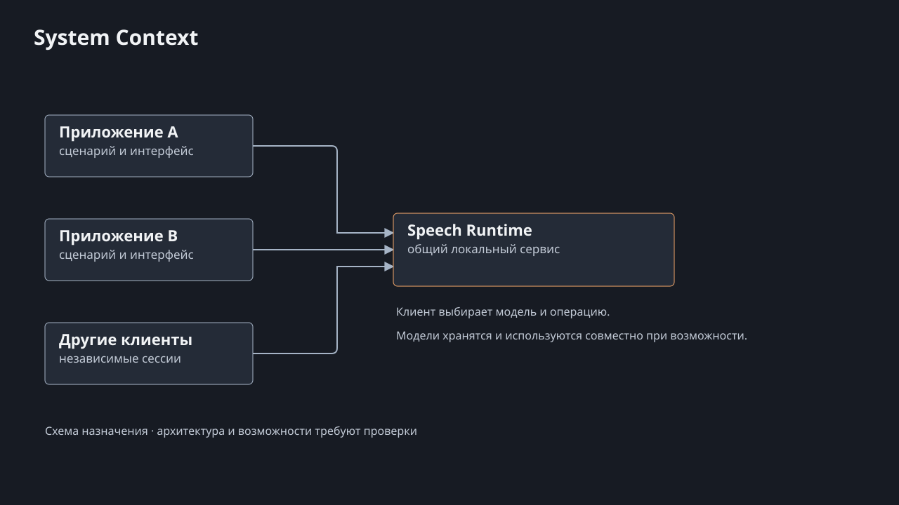
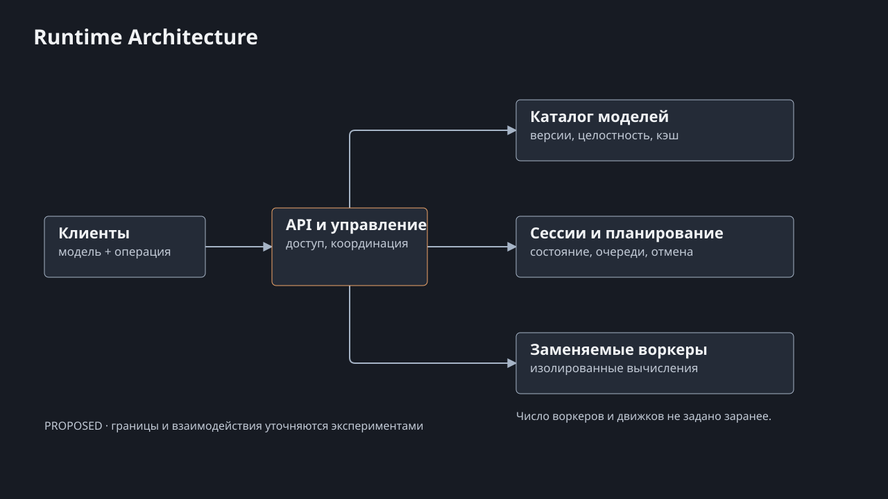
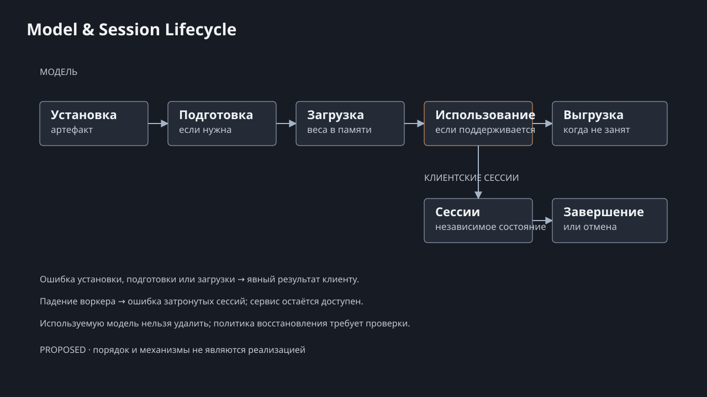

# Архитектура

**PROPOSED:** небольшой управляющий сервис для macOS и изолированные процессы вычислений. Swift — основной кандидат для управляющего сервиса, но выбор подтверждается экспериментами. Это целевая схема, не описание работающего сервиса.

[Редактируемый исходник](diagrams/system-context.html).

## Границы

Клиенты владеют интерфейсом, сценарием, хранением результата и выбором операции и модели. Runtime управляет доступом, каталогом моделей, сессиями и вычислениями; он не выбирает модель по содержанию речи и не управляет LLM. Модель может обслуживать несколько сессий только если это поддерживается выбранным движком и подтверждено измерениями.

[Редактируемый исходник](diagrams/runtime-architecture.html).

| Компонент | Предполагаемая ответственность |
|---|---|
| API | Локальный доступ, проверка полномочий, запросы и события сессии; точный контракт и транспорт не утверждены. |
| Каталог | Идентичность, версии, целостность и состояние установки моделей; лицензия кода, весов и конверсии проверяется отдельно. |
| Сессии | Отдельное состояние, явный выбор модели и операции, отмена и ошибки. |
| Планировщик | Допуск и очереди с учётом realtime и batch; политика определяется замерами. |
| Supervisor | Запуск и наблюдение воркеров, обработка их отказов; восстановление сессий требует отдельного контракта. |
| Воркер и адаптер | Вычисление через выбранный движок; изоляция процесса ограничивает область отказа. Количество воркеров и соответствие движкам не зафиксированы. |

## Модель и сессия

[Редактируемый исходник](diagrams/model-session-lifecycle.html).

Установка и проверка артефакта предшествуют подготовке и загрузке; подготовка может быть ненужной для конкретного движка. Сессия ссылается на конкретную версию. Несколько сессий могут разделять загрузку, но не своё состояние. Выгрузка возможна после завершения использования; удаление используемой версии запрещено, обновление не должно прерывать активную сессию. Ошибки установки, подготовки, загрузки и работы должны быть явными; падение воркера не должно завершать управляющий сервис. Детали восстановления и тайм-аутов ещё не определены.

## Альтернативы

**EXPERIMENT_REQUIRED:** сравнить собственный сервис и актуальные ревизии готовых speech-server, LocalAI и audio.cpp по выбору модели, изоляции сессий, конкурентности, жизненному циклу, безопасности, ресурсам и лицензиям. Их нельзя исключать только по историческому отчёту. audio.cpp включается также в сравнение движков. API over loopback HTTP/WebSocket, LaunchAgent, формат IPC и отдельные исполняемые файлы — варианты, а не утверждённый контракт.

Исходные материалы: [V5](../research/wave2/V5-arch-compare.md), [V7](../research/wave2/V7-critique.md), [V4](../research/wave2/V4-deps-licenses.md). Их результаты относятся к указанным ревизиям и окружению; см. [решения](decisions.md) и [план проверок](validation.md).
