# Универсальный локальный Speech Runtime — итоговый технический отчёт

**Статус:** исследование и проектирование завершены. Runtime не реализован. С 2026-10-26 идёт архитектурная валидация: офлайн-стенд оценки `experiments/asr_eval/` (шаги 0–1 из [V8 §10](../research/wave2/V8-eval-plan.md#10-порядок-работ-пошаговый-план)) и публичный dev-sample `experiments/corpus/`; ASR-модели на них ещё не прогонялись.

**Дата среза:** 2026-10-25/26.

**Первичные материалы:** [`research/wave1/`](../research/wave1/) (18 отчётов), [`research/wave2/`](../research/wave2/) (черновик архитектуры + 8 проверок). Ссылки вида `[A1]`, `[V5]` указывают на эти файлы; permalink'и на код зафиксированы на SHA из таблицы ниже.

## Содержание

| § | Раздел | О чём |
|---|---|---|
| 0 | [Как проводилось исследование](#0-как-проводилось-исследование) | Метод, субагенты, зафиксированные ревизии |
| 1 | [Сравнение готовых проектов](#1-сравнение-готовых-проектов) | 11 проектов: что реально реализовано по коду |
| 2 | [Рекомендуемая основа](#2-рекомендуемая-основа) | Свой сервис + библиотеки движков; что берём из каждого проекта |
| 3 | [Архитектура Runtime](#3-архитектура-runtime) | Процессы, модули, реестр моделей, конкурентность, API v1 |
| 4 | [Матрица моделей](#4-матрица-моделей) | Кандидаты по операциям, ru-метрики, доступные движки, лицензии |
| 5 | [Пробелы](#5-пробелы-что-придётся-разработать-самим) | Что придётся разработать самим и почему |
| 6 | [План реализации](#6-план-реализации-по-зависимостям) | Этапы по зависимостям |
| 7 | [План проверки](#7-план-проверки) | Решающие эксперименты, датасет ru-IT, метрики |
| 8 | [Риски и неизвестные](#8-риски-и-неизвестные) | Подтверждённые риски, открытые вопросы, разбор противоречий |
| 9 | [Рекомендация](#9-рекомендация) | Однозначный вердикт и условия пересмотра |

## 0. Как проводилось исследование

- Субагенты: модель `closerouter/deepseek/deepseek-v4.1-flash-1017` (DeepSeek-V4.1-Flash-1017). Алиаса
  `deepseek-flash` в окружении нет; фактический id найден через `omp models find deepseek`. По умолчанию
  `task`-агенты шли на `deepseek-v4.1-flash` (без `-1017`), поэтому `task.agentModelOverrides` переключён на
  `-1017` **только на эту сессию** (не сохранён). Подмены модели не было.
- Волна 1: 18 параллельных агентов (направления A–K, A и D разбиты на подзадачи, добавлен D3 — Apple
  SpeechAnalyzer). Волна 2: 8 агентов — проверка speech-swift, проверка SpeechRail, поиск готовых реализаций,
  совместимость библиотек и лицензий (с реальной сборкой), сравнение 5 архитектур (с замерами), фактчек
  моделей, независимая критика черновика, план проверки. Два агента волны 2 упали из-за таймаутов провайдера
  и были возобновлены с сохранённым контекстом.
- Ключевые архитектурные выводы приняты только при согласии ≥2 независимых агентов; расхождения разобраны в §8.3.

| Репозиторий | SHA (дата) |
|---|---|
| soniqo/speech-swift | `cbad3be29480825707890490f446b19d7288be2d` (2026-10-25) |
| hrygo/SpeechRail | `cdccc74084bc94f8c996b5b71a386455640ad1cb` (2026-10-25) |
| k2-fsa/sherpa-onnx | `532f1b5a8a207bf53b116b747207c1506696c843` (2026-10-25, v2.0.0) |
| QuentinFuxa/WhisperLiveKit | `eb92c115ee7abc1e161b0b2159da31785b0f5566` (2026-10-18) |
| speaches-ai/speaches | `993994f7984bf3fe9655b267448328cf66fccb42` (2026-04-17) |
| sagostin/gotranscribesrv | `a5f4289078553ba66f83510c62146043bed91a7a` (2026-08-26) |
| FluidInference/FluidAudio | `1b0ed50d686873128a4129b3510ce3914c849bab` (2026-10-24) |
| argmaxinc/WhisperKit (→ argmax-oss-swift) | `9f99b5cb6a907730543823ad271b82532782a899` (2026-10-10) |

---

## 1. Сравнение готовых проектов

| Проект | Что это по коду | Многоклиентность | Выбор модели в запросе | Управление моделями | Стриминг ASR | VAD / диаризация / эмбеддинги | Лицензия, активность | Вердикт |
|---|---|---|---|---|---|---|---|---|
| **speech-swift** | Монорепо Swift-библиотек: 61 модуль, MLX + CoreML, + Hummingbird-сервер [B2] | Один `InferenceGate` на процесс: 1 слот + FIFO 32 ([InferenceGate.swift#L5-L99](https://github.com/soniqo/speech-swift/blob/cbad3be29480825707890490f446b19d7288be2d/Sources/SpeechRuntime/InferenceGate.swift#L5-L99)); тест фиксирует `maximum == 1` ([ASRRuntimeRegressionTests.swift#L84-L107](https://github.com/soniqo/speech-swift/blob/cbad3be29480825707890490f446b19d7288be2d/Tests/AudioServerTests/ASRRuntimeRegressionTests.swift#L84-L107)) | Есть, по реестру из 48 записей, но диспетчеризуются 29 [B1, V1] | `ModelCache` никогда не выгружает ([ModelCache.swift#L6-L33](https://github.com/soniqo/speech-swift/blob/cbad3be29480825707890490f446b19d7288be2d/Sources/SpeechRuntime/ModelCache.swift#L6-L33)); загрузчик HF с sha256 — лучший среди изученных [G] | Нет: сервер вызывает streaming-модели как batch [V1 п.1] | В библиотеке есть; HTTP-маршрутов VAD/diarize/speaker нет ([AudioServer.swift#L96-L152](https://github.com/soniqo/speech-swift/blob/cbad3be29480825707890490f446b19d7288be2d/Sources/AudioServer/AudioServer.swift#L96-L152)) | Apache-2.0; 655 коммитов/180 дн, 1 мейнтейнер, версия 0.0.x | **Библиотека моделей — да; сервер как основа — нет** |
| **SpeechRail** | Python 3.14/FastAPI-супервизор + MLX-воркеры по framed IPC, macOS 26+ [C, V2] | Batch XOR streaming (`backend_busy`) [V2] | Нет: `model=` — декоративный алиас единственного активного артефакта [V2 п.3b] | Лучший манифест: `ArtifactFile`/`SourceLocation`/`QuantizationSpec`/`RuntimeLock`, staging→sha256→atomic publish, но нет GC `.releases` [V2] | Да, `revision`+`stable_prefix_codepoints` | Только Swift-диаризатор; эмбеддингов нет | MIT; 1483 коммита, фактически 1 автор (2 email) [V2] | **Только архитектурные решения** |
| **sherpa-onnx** | C++ ONNX-движок + 3 семейства демо-серверов [A1] | Правильная модель: 1 `OnlineRecognizer` + N `OnlineStream` + `DecodeStreams` батч ([online-websocket-server-impl.cc#L185-L215](https://github.com/k2-fsa/sherpa-onnx/blob/532f1b5a8a207bf53b116b747207c1506696c843/sherpa-onnx/csrc/online-websocket-server-impl.cc#L185-L215)) | Нет: модель фиксируется путями при старте | Нет вообще | Да (transducer/CTC, Nemotron 3.5, T-one) | VAD, offline-диаризация, эмбеддинги, KWS, пунктуация | Apache-2.0; 265 коммитов/6 мес, bus-factor ≈1 | **Основной ONNX-движок; CoreML EP в macOS-сборках выключен** ([onnxruntime-osx-arm64-static.cmake#L61-L62](https://github.com/k2-fsa/sherpa-onnx/blob/532f1b5a8a207bf53b116b747207c1506696c843/cmake/onnxruntime-osx-arm64-static.cmake#L61-L62)) |
| **FluidAudio** | Swift CoreML-библиотека, 0 зависимостей [B2, E2] | Actor-менеджеры, `preloadShared` (1× веса + N× состояние) [D2] | — | Свой загрузчик (третий каталог) | Nemotron 3.5 multilingual (ru) CoreML ([ModelNames.swift#L63](https://github.com/FluidInference/FluidAudio/blob/1b0ed50d686873128a4129b3510ce3914c849bab/Sources/FluidAudio/ModelNames.swift#L63)), Parakeet EOU/Unified | Silero, pyannote+WeSpeaker VBx, Sortformer, Nemotron-3-Diarization ([#L75](https://github.com/FluidInference/FluidAudio/blob/1b0ed50d686873128a4129b3510ce3914c849bab/Sources/FluidAudio/ModelNames.swift#L75)) | Apache-2.0; 60 коммитов/30 дн | **Основной CoreML-движок** |
| **WhisperKit / argmax-oss-swift** | Swift CoreML Whisper + SpeakerKit + TTSKit [A3] | Один инстанс, сервер `serve` собирается только с `BUILD_ALL=1` | `model` только логируется | `ModelManager` с state machine — хороший образец | Только по файлу (SSE); real-time WS — платный Pro | Только EnergyVAD; SpeakerKit (pyannote v4) | MIT | **Адаптер Whisper на CoreML; сервер — нет** |
| **WhisperLiveKit** | FastAPI-монолит, синглтон движка [A2] | N WS-сессий, инференс под общим lock (LocalAgreement) | `model` игнорируется | Одна модель на процесс, без выгрузки | Да (LocalAgreement, SimulStreaming) | Silero, Sortformer/diart | Apache-2.0; активен | **Алгоритмы стриминга и протокол — да** |
| **speaches** | FastAPI, OpenAI-совместимый [A2] | Есть | Есть | `SelfDisposingModel`: refcount + TTL | Нет (VAD-нарезка + loopback HTTP) | Только VAD | MIT; заморожен с 2026-04-17, RCE-issue #679 открыт | **Только идея refcount+TTL** |
| **gotranscribesrv** | Go-биллинговый шлюз + Swift-сайдкар FluidAudio [A3] | Стриминговый движок создаётся на каждое WS (N копий весов) | Нет | Нет | Да, хороший событийный протокол | Silero, Sortformer | **GPL-3.0**, 1 автор | **Только идеи протокола** |
| **audio.cpp** (0xShug0) | C++/ggml HTTP-сервер, конфиг-реестр [A4, V3] | per-model busy-lock → 503 | Да | `lazy_load`, `max_loaded_models`, `idle_unload_ms` | Нет WS | VAD, диаризация; эмбеддингов нет | Apache-2.0; CUDA-first | **Копировать `model_slots.h`/`busy_guard.h` как идею** |
| **LocalAI** | Go-супервизор + бэкенды-процессы по gRPC [A4, V5] | Да | Да | Watchdog idle/busy/LRU/memory, pinned, groups | `/v1/realtime` | Зависит от бэкенда | MIT; активен | **Образец супервизора и `backend.proto`; нет CoreML/MLX** |
| Wyoming, whisper.cpp server, vosk-server, mlx-audio, Ollama | [A4] | — | — | — | — | — | — | Wyoming — образец протокола; остальные отсеяны (глобальный мьютекс, заброшен, сериализация GPU, Ollama ASR = чат-запрос к LLM) |
| **Apple SpeechAnalyzer** | Системный API [D3] | Веса вне процесса, 6 процессов / 16 анализаторов параллельно | — | Системные ассеты | `SpeechTranscriber` — **ru_RU нет** (45 локалей, измерено на macOS 27.0); `DictationTranscriber` — ru есть | — | системный | **Опциональный адаптер, позже** |

Итог по рынку: прямого аналога «Ollama для речи» нет [A4, J]. OWhisper (289 баллов на HN) удалён, speaches
заморожен; сообщество прямо просит «стандартный локальный сервер» [J п.9–10].

---

## 2. Рекомендуемая основа

**Собственный сервис.** Существующие проекты используются как **библиотеки движков внутри воркеров**, а их
серверы — как источник проверенных решений. Форк любого сервера отклонён.

Почему не форк speech-swift (основного кандидата):

1. Сервер закрывает 2 из 13 пунктов цели полностью и 9 не закрывает [V1 п.9]. Три пункта — одновременные
   сессии, единый API, адаптеры движков — упираются в позицию автора: модели «not thread-safe by design»
   (`docs/shared-protocols.md:591-595`), кэш «remain resident for the server's lifetime»
   (`docs/inference/model-runtime.md:36-37`).
2. `AudioServer` — не библиотечный продукт SPM, только `.target` за исполняемым `speech-server` [V1 п.6]:
   «подключить сервер как библиотеку» нельзя в принципе.
3. Развитие идёт в сторону новых моделей: из 12 коммитов в серверных каталогах с 2026-09-01 все про модели.
   В roadmap (discussion #81) сервер отнесён к слою «Apps», слоя «runtime/daemon» нет [V1 п.7]. Форк будет
   постоянно расходиться с upstream при 655 коммитах за 180 дней.
4. Публичный API библиотек при этом стабилен: за 4 тега 0 удалённых или изменённых публичных объявлений
   [V1 п.8]. Использовать их как зависимость — разумно.

Почему не SpeechRail: один активный профиль на машину, batch XOR streaming, только Qwen3, Python [C, V2].

Что берём из каждого проекта:

| Источник | Что берём | Как |
|---|---|---|
| sherpa-onnx | GigaAM v3 (CTC/RNNT/e2e), Nemotron 3.5 streaming, T-one, Whisper, Canary, Parakeet, Silero/FireRed VAD, эмбеддинги; модель «1 recognizer + N stream + батч» | зависимость (Swift-пакет / C API) |
| FluidAudio | CoreML: Nemotron 3.5 multilingual streaming + decode-time hotwords ([NemotronVocabularyBias.swift](https://github.com/FluidInference/FluidAudio/blob/1b0ed50d686873128a4129b3510ce3914c849bab/Sources/FluidAudio/ASR/Parakeet/Streaming/Nemotron/NemotronVocabularyBias.swift)), Parakeet TDT v3 + CTC-rescoring словаря ([VocabularyBoostingSession.swift](https://github.com/FluidInference/FluidAudio/blob/1b0ed50d686873128a4129b3510ce3914c849bab/Sources/FluidAudio/ASR/Parakeet/SlidingWindow/CustomVocabulary/VocabularyBoostingSession.swift)), Silero, offline-диаризация VBx, Nemotron-3-Diarization, Sortformer, `SpeakerManager` | зависимость |
| speech-swift | MLX-реализации (Qwen3-ASR, Voxtral, Nemotron, Omnilingual), `AudioCommon/Protocols.swift` (14 протоколов) как стартовый эскиз интерфейса адаптера, HF-загрузчик с sha256, харнессы `asr-bench`/`diarization-bench`/`vad-bench` [V8] | зависимость + образец |
| WhisperKit | Whisper large-v3-turbo на CoreML; `ModelManager` (state machine, коалесинг загрузок) как образец | зависимость (опционально) |
| SpeechRail | манифест артефакта, staging→verify→atomic publish, `RuntimeLock`, governor классов работ с резервом realtime, framed IPC, launchd-семантика, `ServerInstanceLock`, partial `revision`+`stable_prefix` [V2 «Что заимствовать»] | идеи (MIT, перенос возможен) |
| Ollama | CAS `blobs/sha256-*` + манифесты, **manifest list с полем `runner`**: одна логическая модель → N артефактов под движки; планировщик `refCount`+`keep_alive`; раннеры-подпроцессы с health [G] | идеи (MIT) |
| LocalAI, audio.cpp | watchdog (idle/busy/LRU/memory, pinned, groups), `backend.proto` (AudioTranscriptionLive bidi, VoiceEmbed, LoadModel/Free/Status), fail-fast 503 `server_busy` [A4, V3] | идеи |
| WLK, gotranscribesrv, Wyoming, Deepgram | алгоритмы стриминга (LocalAgreement, buffer trimming, VAD-clamping), имена событий, `describe/info` [A2, A3, H] | идеи (gotranscribesrv — GPL, код не копировать) |

**Проверено сборкой:** speech-swift + FluidAudio + argmax-oss-swift + sherpa-onnx Swift-пакет разрешаются и
линкуются в **один** Swift-бинарь: `swift build` → `EXIT=0`, запуск → `sherpa-onnx 2.0.0, onnxruntime
1.28.2`, один экспорт `_OrtGetApiBase`, внешних dylib нет [V4]. В Rust связка `ort` + `sherpa-onnx` дала
десятки `duplicate symbol` [V4].

---

## 3. Архитектура Runtime

### 3.1 Процессы


*Рис. 1. Control plane и воркеры. Интерактивная версия — [`diagrams/architecture.html`](diagrams/architecture.html).*

Решения и обоснования:

| Решение | Обоснование |
|---|---|
| **Control plane на Swift, не Rust** | Выигрыш Rust измерен: 1.98 MB против 6.16 MB RSS и ~3 мс старта [V5 §4.1]. Цена: второй тулчейн, вторые CI/подпись/нотаризация, дублирование типов протокола, потеря общего `Codable`-слоя со Swift-клиентами [V5 §6, V7 §3]. Изоляцию сбоев дают процессы, а не язык супервизора. F рекомендовал Rust, V5 и V7 независимо опровергли; F сам признаёт, что «решает не скорость языка». |
| **Воркер-процессы по семействам движков с первого дня** | MLX превращает ошибки в `fatalError`, thread-local streams дают падение «no Stream(gpu,0)» [J п.5, F п.4]. Параллельные CoreML ASR и диаризация в одном процессе дают `EXC_BAD_ACCESS`; FluidAudio issue #661 закрыт как ошибка интеграции, без фикса в библиотеке [V5 §3.3]. Убийство процесса — единственный гарантированный способ вернуть Metal/ANE-кэши. Старт воркера стоит 3–17 мс и 6–18 MB [V5 §4.1]. |
| **Гранулярность — семейство движков, а не модель** | GPU сериализует работу между процессами: 1/2/4 процесса → 0.133/0.257/≈0.48 мс на операцию, суммарный throughput не растёт [V5 §4.2]. MLX читает safetensors через `read()`/`pread()` в приватный буфер, `mmap` в MLX нет ([safetensors.cpp#L216-L217](https://github.com/ml-explore/mlx/blob/1f8e74e3f12f31365464a6867c6579f0e9b29d85/mlx/io/safetensors.cpp#L216-L217), [load.cpp#L30-L38](https://github.com/ml-explore/mlx/blob/1f8e74e3f12f31365464a6867c6579f0e9b29d85/mlx/backend/common/load.cpp#L30-L38)), поэтому каждый процесс с моделью — это полная копия весов. Второй MLX-процесс только явно, с учётом ×2 памяти в бюджете. |
| **Один multi-call бинарь** | Все библиотеки линкуются вместе [V4], поэтому `speechd` и воркеры могут быть одним подписанным исполняемым файлом с ролью из `argv`: одна нотаризация, изоляция сохраняется. Образец — Handy `engine_supervisor` [V3 п.7]. |
| **Протокол воркера — точка расширения** | Сторонний движок — это новый бинарь, реализующий протокол воркера; супервизор не меняется. RPC-набор по образцу LocalAI `backend.proto`: Load/Unload/Status/Transcribe/StreamOpen/StreamAudio/StreamClose/Embed/Diarize/Cancel [V3 п.9]. |

### 3.2 Модули speechd

| Модуль | Ответственность | Образец |
|---|---|---|
| API gateway | Маршрутизация, auth, валидация, ошибки RFC 9457 (на OpenAI-путях — конверт OpenAI), версия протокола | [H] |
| Model Registry | Каталог, pull/verify/prepare/remove/GC, revisions, лицензии, манифест-лист по движкам | Ollama + SpeechRail + HF cache [G, V2] |
| Scheduler | Резидентность (lease/refcount/TTL/pinned), бюджет памяти, admission, очереди realtime > interactive > batch, учёт GPU-времени | Ollama `sched.go`, LocalAI watchdog, SpeechRail governor [G, V3] |
| Session manager | Жизненный цикл сессий, per-op модели, checkpoint, backpressure, отмена | SpeechRail, WLK [V2, A2] |
| Worker supervisor | spawn, health, перезапуск с backoff, кварантин после N падений, lease-файлы для восстановления после падения демона | Ollama runner, Handy [G, V3] |
| Bias compiler | `bias{terms, strength}` → механизм конкретного движка + отчёт `applied/rejected` | [I, V3 п.10] |
| Speaker store | Хранилище эмбеддингов с `encoder_family`+`encoder_weights`; stateless `match` с порогом и margin | LocalAI `KnownVoice`, FluidAudio `SpeakerManager` [V3 п.6, E2] |

### 3.3 Управление моделями

Раскладка на диске (по [G]):
```
~/Library/Application Support/SpeechRuntime/
  blobs/sha256-<hex>            # CAS, дедупликация между моделями и ревизиями
  manifests/<model_id>/<revision>.json
  builds/<artifact_id>/<revision>/   # материализованное дерево (clonefile/hardlink), .mlmodelc после компиляции
  state/models/<model_id>.json  # активная ревизия, публикуется последним шагом (atomic rename)
  state/leases/                 # аренды сессий для восстановления после падения
  staging/  locks/  cache/ane/  # кэш компиляции CoreML не удаляется при выгрузке
```

- **Логическая модель → артефакты по движкам** (manifest list, как у Ollama): `gigaam-v3-e2e-rnnt` →
  `onnx-int8`, `coreml-fp16`, `mlx-bf16`. Клиент обязан назвать модель и может явно назвать артефакт или
  движок. При одном подходящем артефакте runtime выбирает его детерминированно по платформе — это выбор
  формата, а не модели по смыслу запроса.
- **Поля манифеста:** `schema_version`, `model_id`, `revision` (40-hex upstream + монотонная локальная),
  `operations[]`, `languages[]`, `artifacts[]` {`engine`, `engine_abi`, `format`, `quantization`,
  `streaming`, `concurrency: shared-batched|shared-serialized|replicated`, `footprint` (заявленный и
  **измеренный** `phys_footprint`), `files[]{path,size,sha256}`, `sources[]{provider,repo,revision}`},
  `license{upstream, artifact, gated, mirror_allowed, notice}`. Две лицензии нужны потому, что конверсии
  перелицензируются: `onnx-community/...-int4` = MIT при OpenMDW-оригинале, `aufklarer/WeSpeaker-*` = MIT при
  CC-BY-4.0, `aufklarer/Nemotron-3.5-*-MLX` под **NVIDIA Evaluation License** с запретом production
  [V4, V6 п.8].
- **Состояния установки:** `absent → downloading → verifying → downloaded → preparing (компиляция ANE, прогрев)
  → ready`, плюс `failed`. `prepare` — отдельная операция API: компиляция CoreML занимает от 10 с до ~7 мин
  по документации FluidAudio [V7 п.4] и 440–560 с у large-v3-turbo по сообщениям сообщества [J п.6]. При
  ошибке специализации ANE результат не кэшируется и компиляция повторяется на каждом старте [J п.6].
- **Состояния инстанса:** `cold → loading → warm → busy(refcount>0) → idle(TTL) → unloading`. Модель с
  `refcount>0` не выгружается никогда. `DELETE` при активных арендах → `409 model_in_use`.
- **Обновление при живой сессии:** сессия фиксирует `resolved_revision` при открытии и дорабатывает на ней;
  новые сессии получают новую ревизию; старая выгружается после освобождения последней аренды. Откат —
  переключение указателя в `state/models`. GC удаляет blobs без ссылок (у SpeechRail GC нет — это его
  дефект [V2 п.5]).
- **Целостность:** sha256 всех файлов при записи и периодическая проверка по запросу. Ollama не перепроверяет
  при кэш-попадании [G]; `hf-hub` sha256 не проверяет [V3 п.4].
- **Gated-модели** (pyannote community-1): только download-at-source с токеном пользователя, без зеркала [K п.5].

### 3.4 Конкурентность и жизненный цикл

| Движок | Режим | Веса | Сессии | Правила |
|---|---|---|---|---|
| sherpa-onnx | shared-batched | 1 recognizer на (модель, `decoding_method`) | N `OnlineStream`, батч `DecodeStreams` | `decoding_method` задаётся на recognizer, а не на сессию. Первый клиент с `bias` поднимает второй recognizer в `modified_beam_search`, и в бюджете это ×2 памяти [V7 п.8]. Отдельный recognizer на класс работ, чтобы batch не попадал в один encoder-вызов с realtime. `GetResult`/`SetStates` — под замком [A1]. |
| CoreML | replicated | N инстансов | 1 инстанс на поток | Документация Apple: «one thread or one dispatch queue at a time» [V5 §3.2]. `max_instances` берётся из бюджета; ANE выходит на плато при N≥4 [D2]. Разные CoreML-модели в одном воркере вызываются строго сериализованно, пока E2 не покажет обратное (FluidAudio #661). |
| MLX | shared-serialized | 1 | очередь | Глобальный `evalLock` [F]; явный лимит кэша MLX (без него пик 19–23 GB [J п.5]). |
| Apple Speech | system-shared | вне процесса | N | Модуль и анализатор создаются на каждую сессию: переиспользование модуля даёт SIGTRAP [D3 п.6]. Лимит 5 резерваций локалей. |

- **Admission:** запрос принимается, только если хватает измеренного `phys_footprint` и есть резерв realtime
  (байты и GPU-время). Иначе `503 memory_budget_exhausted` или `server_busy` с `Retry-After`. Число воркеров
  не масштабирует GPU [V5 §4.2].
- **Падение воркера посреди стрима:** клиент получает событие `worker_restarted`. Сессия продолжается с
  checkpoint (`stable_prefix`, `audio_offset`); незафиксированный хвост клиент досылает из своего буфера,
  длина которого объявляется в handshake (`replay_window_ms`). Без такого буфера — `error` и закрытие с кодом
  1011. Сценарий не описан ни в одном изученном проекте [V7 п.5].
- **Отмена:** `POST /v1/jobs/{id}:cancel` для batch и сообщение `cancel` в WS. Если движок не прерывается,
  супервизор после таймаута убивает воркер (паттерн Handy [V3 п.7]).

### 3.5 API v1

Полный черновик спецификации — [H]; дельты из критики — [V7 §8.2]. Итоговый контракт:

**Транспорты.** Основной — HTTP/1.1 + WebSocket на `127.0.0.1:<port>`: это минимальный транспорт, который
работает для всех клиентов, в том числе из App Sandbox с `com.apple.security.network.client` (измерено:
`CONNECT_OK`, без entitlement — `EPERM`) [V7 §9]. UDS — оптимизация для CLI, Rust и приложений своей команды
разработчиков: сокет в `~/Library/Group Containers/<team>.speechruntime/`. Сокет в Application Support из
sandbox даёт `EPERM` даже с file-исключением [V7 §9]. gRPC и XPC в v1 не входят: клиента, которому они нужны,
нет, а XPC к чужому демону требует temporary-exception [V7 п.6]. MAS-приложение не может само установить
демон: запись в LaunchAgents из sandbox → `EPERM` [V7 §9]. Демон ставится отдельным установщиком или
Homebrew, приложение его обнаруживает.

**Безопасность.** Bind только на loopback. Bearer-токен генерируется при первом старте и хранится в файле с
правами 0600. Allowlist для `Origin` и `Host` защищает от атак из браузера на localhost (сейчас у speech-swift
и WLK этой защиты нет). Для WS — одноразовый ticket вместо токена в query. В `transcribe` нет `file://`: аудио
передаётся в теле запроса. Для UDS дополнительно проверяется `getpeereid`.

**Эндпоинты (native):**

| Операция | Метод и путь |
|---|---|
| capabilities, health | `GET /v1/capabilities`, `GET /v1/health` (состояние воркеров, загрузок, очередей) |
| listModels / model info | `GET /v1/models`, `GET /v1/models/{id}` |
| install / update | `POST /v1/models/{id}/pull` (`revision?`, `artifact?`) → job с прогрессом |
| prepare | `POST /v1/models/{id}/prepare` (скачать, скомпилировать, прогреть) |
| loadModel / unloadModel | `POST /v1/models/{id}/load` (`keep_alive`, `pinned`), `POST /v1/models/{id}/unload` |
| remove / rollback | `DELETE /v1/models/{id}[@rev]` (409 при арендах), `POST /v1/models/{id}/activate` (`revision`) |
| ps | `GET /v1/ps`: `state`, `instances`, `refcount`, `phys_footprint_bytes`, `queue_depth{realtime,interactive,batch}` |
| transcribe (batch) | `POST /v1/transcribe`: multipart или raw; `model[@rev]`, `language?`, `timestamps: none\|segment\|word`, `bias?`, `itn?`, `vad?`, `diarize?{model}` |
| detectSpeech | `POST /v1/vad` → сегменты речи |
| diarize | `POST /v1/diarize` → RTTM-подобные сегменты, `max_speakers`, `embedding_model?` |
| speakerEmbedding | `POST /v1/embeddings/speaker` → вектор + `encoder_family`, `encoder_weights`, `dim` |
| speaker match | `POST /v1/speakers/match` (`embedding_model`, `threshold`, `margin`, кандидаты) → id или `unknown` |
| speaker store | `PUT/GET/DELETE /v1/speakers/{id}` — опционально; личности и согласие на хранение остаются за клиентом [E2] |
| bias dictionaries | `PUT/GET/DELETE /v1/dictionaries/{id}` |
| jobs | `GET /v1/jobs/{id}`, `POST /v1/jobs/{id}:cancel` |
| stream | `WS /v1/stream` |

**WS `/v1/stream`.** Клиент присылает `session.config`:
`{protocol: "speech/1", ops: [{op: "asr"|"vad"|"eot"|"diarize", model, params}], audio: {encoding:
"pcm_s16le"|"f32le", sample_rate, channels}, bias?, max_inflight_audio_ms, replay_window_ms}`. Затем идут
бинарные аудиокадры. События: `session.ready{resolved_models[]}`, `vad.start/end`,
`asr.partial{revision, stable_prefix_chars, text}`, `asr.final{segment_id, words[], ts}`, `eot`,
`speaker{segment_id, label}`, `bias_report`, `worker_restarted`, `error{code}`. Клиент может отправить
`flush`, `cancel`, `close`. Partial — это замена текста с ревизией, а не append-only дельта [H п.2]. Сервер
вправе отбрасывать partial, но не final; если final не доставлен, сессия закрывается с кодом 1011.
Собственные close-коды — 4000–4999. Модель задаётся на каждую операцию отдельно: ASR, VAD и диаризация — это
разные модели [V7 п.2].

**OpenAI-совместимый слой:** `POST /v1/audio/transcriptions` (поле `model` обязательно и действительно
выбирает модель — в отличие от WLK, speaches, gotranscribesrv и WhisperKit), `GET /v1/models` (надмножество)
и realtime-сессия транскрипции, которая честно отдаёт только `completed`. Это отображение событий поверх
того же ядра, а не второй сервер [H п.1, п.3].

**Ошибки и версии.** Единый словарь `code`: `model_not_found`, `model_not_ready`, `model_in_use`,
`unsupported_operation`, `memory_budget_exhausted`, `server_busy`, `worker_crashed`, `bias_unsupported`,
`audio_format_invalid`, `version_unsupported`. Версия протокола задаётся префиксом `/v1` и полем `protocol`
в handshake; несовместимость → `version_unsupported` с перечнем поддерживаемых версий. Каждый ответ содержит
`resolved_model`, `resolved_revision`, `engine`.

**SDK.** Swift и Rust генерируются из OpenAPI (`swift-openapi-generator`, `progenitor`). WS-типы пишутся
вручную: зрелых генераторов AsyncAPI для Swift и Rust нет [V3 п.11].

### 3.6 Граница runtime и приложения

| Runtime делает | Приложение делает |
|---|---|
| Явно указанную операцию на явно указанной модели | Выбор модели под сценарий, диалог, LLM, инструменты |
| VAD/EOT-события, endpointing выбранного владельца (один владелец, защита от двойного final [E1 п.9]) | Политику порогов, barge-in, AEC/AGC, pre-roll |
| Компиляцию `bias` в механизм движка, отчёт `applied/rejected`, хранение именованных словарей | Источник терминов, накопление исправлений, LLM-коррекцию |
| ITN как опция запроса (`itn: off\|rules`) | Транслит → латиница, если это языковая политика продукта (решится по E6) |
| Эмбеддинги и stateless match с порогом и margin, опциональное хранилище векторов | Личности, согласие, retention, привязку к календарю встреч |

---

## 4. Матрица моделей

Данные выверены в [V6] по первоисточникам. Все метрики официальные, если не помечено иначе. На русской
IT-речи и при code-switching **не измерена ни одна модель** [V6 п.10, V8 п.1]. Матрица задаёт кандидатов;
выбор делается по экспериментам E1–E3 (§7).

| Операция / сценарий | Кандидаты (HF id) | ru-метрика | Стриминг | Движки, где существуют | Лицензия |
|---|---|---|---|---|---|
| Batch, точный ru | `ai-sage/GigaAM-v3` (`rnnt`, `ctc`) | WER 8.3 % (RNNT, среднее по 10 наборам) | нет | ONNX (sherpa, `istupakov/gigaam-v3-onnx`); CoreML и MLX — только community | MIT; в старых пакетах встречается `GigaAM License_NC.pdf` — лицензию фиксировать по артефакту [V7] |
| Batch ru с пунктуацией и латиницей | `GigaAM-v3` `e2e_rnnt` | WER 11.2 %, F1(,) 84.5 | нет | ONNX | MIT |
| Batch, смешанный ru/en | `openai/whisper-large-v3-turbo` | аудиокниги ru 9.89 % (сторонний бенчмарк); на латинице лучше GigaAM: 7.89 % против 10.27 %, n=38 [J, V6 п.9] | нет (эмуляция через LocalAgreement) | CoreML (WhisperKit), ONNX (sherpa), MLX (community) | MIT |
| Batch, мультиязычный | `nvidia/parakeet-tdt-0.6b-v3`; `nvidia/canary-1b-v2`; `Qwen/Qwen3-ASR-1.7B` | FLEURS ru 5.51 / 6.90 / 5.99 | нет | Parakeet: CoreML (FluidAudio), MLX, ONNX; Canary: CoreML, ONNX; Qwen3: MLX (speech-swift) | CC-BY-4.0 / CC-BY-4.0 / Apache-2.0 |
| **Стриминг ru** | `nvidia/nemotron-3.5-asr-streaming-0.6b` | FLEURS ru 9.60 % @560 мс, 9.17 % @1.12 с | да, 80–1120 мс | **CoreML (FluidAudio multilingual + decode-time hotwords)**, ONNX (sherpa), MLX | OpenMDW-1.1; MLX-конверсии `aufklarer` — Evaluation License, не использовать |
| Стриминг ru, высокая точность | `mistralai/Voxtral-Mini-4B-Realtime-2602` | FLEURS ru 6.02 % @480 мс | да | MLX (`mlx-community`), ONNX; CoreML нет | Apache-2.0 |
| Стриминг ru, CPU и телефония | `t-tech/T-one` | call-center 8.63 % | да, 300 мс | ONNX | Apache-2.0; **латиницы и цифр нет в алфавите** (35 символов) — для IT-терминов не годится [V6 п.6] |
| Стриминг с атрибуцией спикера | `microsoft/VibeVoice-ASR-Streaming-7B/1.5B` | ru 15.67 % WER | да | MLX | MIT |
| Системный | Apple `DictationTranscriber` | не измерено | да | Apple | системный |
| VAD | Silero VAD 6.2.x; FireRedVAD | F1 95.95 / 97.57 на FLEURS-VAD-102 | да | CoreML, MLX, ONNX | MIT / Apache-2.0 |
| EOT (конец реплики) | Smart Turn v3.2 (23 языка, ru есть) | — | да | CoreML, ONNX | BSD-2 |
| Диаризация, стриминг и offline | `nvidia/Nemotron-3-Diarization` (до 8 спикеров) | DIHARD III 12.73 % (англ.) | да | CoreML (FluidAudio), MLX, ONNX | OpenMDW-1.1 |
| Диаризация, offline | pyannote community-1 (FluidAudio VBx) | AMI SDM 19.9 % (официально); у FluidAudio 10.62 % на AMI SDM (их бенчмарк) | нет | CoreML | CC-BY-4.0, gated |
| Эмбеддинги спикера | WeSpeaker ResNet34-LM (256-d); CAM++ (192-d) | EER 0.723 % / 0.65 % (vox1-O) | — | CoreML, MLX, ONNX | CC-BY-4.0 / Apache-2.0 |
| **Исключить** | Sortformer v1 (CC-BY-NC), DiariZen (CC-BY-NC), TEN VAD (запрет развёртывания «для третьих лиц»), SenseVoice (нет ru) | | | | [K, V4, V6] |

Пространства эмбеддингов разных моделей несовместимы, поэтому в записи спикера хранятся
`encoder_family`+`encoder_weights`, а при смене модели — пересчёт [E2, V3 п.6].

---

## 5. Пробелы: что придётся разработать самим

| Пробел | Готовых решений нет, потому что | Что есть в помощь |
|---|---|---|
| Демон, объединяющий движки CoreML, MLX и ONNX с общим каталогом | Каждый проект — сервер вокруг одного движка [A4] | Образцы LocalAI и Ollama |
| Реестр: CAS + manifest list по движкам + две лицензии + `prepare` + GC | Ollama без речевых движков, у SpeechRail нет GC, у `transcribe-catalog-v1` нет хешей [A4, V2] | Схемы Ollama, SpeechRail, HF cache |
| Планировщик с учётом памяти и GPU-времени для разнородных движков | Ollama и LocalAI мерят память LLM-раннеров; сериализацию GPU между процессами никто не учитывает [V5 §4.2] | `sched.go`, watchdog |
| Протокол стрим-сессии с ревизиями partial, per-op моделями, checkpoint и backpressure | Ни у кого нет полного набора [H, V7] | События SpeechRail, WLK, Deepgram, Wyoming |
| Восстановление стрима после падения воркера | Не описано нигде [V7 п.5] | — |
| Компилятор `bias` для разных движков | Механизмы несовместимы: sherpa ContextGraph (только трансдьюсеры + mbs), FluidAudio CTC-rescoring и Nemotron shallow fusion, prompt для Whisper/Qwen3/Voxtral [I, V3] | Реализации в sherpa-onnx и FluidAudio |
| Обход ловушки GigaAM charwise: пробел недостижим из hotwords, многословные фразы не скорятся [I п.3] | Не документировано | Варианты: BPE-модель punct, свой токенайзер hotwords |
| Speaker store с пороговым match и `unknown` | У speaches argmax без порога (антипаттерн) [E2] | FluidAudio `SpeakerManager`, sherpa `SpeakerEmbeddingManager` |
| Безопасный локальный доступ (токен, Origin, sandbox) | Ни у одного проекта нет auth [B1, A2] | Измерения V7 §9 |
| Харнесс оценки ru-IT и сам датасет | Публичного ru code-switching/IT-набора нет [V8 п.1] | `asr-bench` speech-swift, но в нём нет sherpa и он теряет регистр [V8 п.3–4] |

---

## 6. План реализации по зависимостям



*Рис. 2. Порядок этапов. Этапы 2 и 3 независимы и идут параллельно. Интерактивная версия — [`diagrams/plan.html`](diagrams/plan.html).*

| Этап | Содержание | Выход (критерий готовности) |
|---|---|---|
| **0. Риск-спайки** (до фиксации контракта) | (a) CoreML: холодная компиляция Nemotron 3.5 multilingual и Parakeet v3, `phys_footprint`, 2–4 параллельные сессии, совместная работа ASR и диаризации в одном процессе. (b) sherpa: GigaAM RNNT и Nemotron 3.5 при 1/4/8 стримах, `greedy` против `modified_beam_search`+hotwords, память второго recognizer. (c) MLX: возврат памяти после unload. Параллельно — сбор датасета ru-IT и E1, E3, E4, E6 офлайн | Измеренные числа для модели конкурентности и бюджета; выбор основной ru-модели |
| 1. Ядро | speechd (Hummingbird 2 + NIO), auth, реестр (CAS, pull, verify, prepare, revisions, GC), супервизор, worker-onnx, `POST /v1/transcribe`, `/v1/models*`, `/v1/ps` | GigaAM v3 batch через API; kill воркера не валит демон |
| 2. Стриминг | WS `/v1/stream`, Nemotron 3.5 и GigaAM-стриминг на sherpa, Silero VAD, Smart Turn, partial с ревизиями, backpressure, checkpoint | Два одновременных стрима и batch-фон с измеренной деградацией realtime |
| 3. Apple-движки | worker-coreml (FluidAudio: Nemotron 3.5 ru streaming, Parakeet v3; WhisperKit), worker-mlx (Qwen3-ASR, Voxtral Realtime), `replicated` и `serialized` режимы, кэш ANE | Та же модель доступна через два движка с одним контрактом |
| 4. Адаптация | `bias` для трёх механизмов + `bias_report`, словари, `itn` | Измеренный прирост term recall на ru-IT при контроле ложных срабатываний |
| 5. Спикеры | `/v1/vad`, `/v1/diarize` (Nemotron-3-Diarization, FluidAudio VBx), `/v1/embeddings/speaker`, `/v1/speakers/match` | DER и EER на русских встречах |
| 6. Эксплуатация | Обновление и откат при живых сессиях, TTL/pinned, восстановление по lease, метрики, логи, обновление самого демона | Soak-тест 24 ч |
| 7. Интеграция | OpenAI-compat слой, SDK Swift/Rust, установщик или Homebrew, нотаризация, опционально worker-apple | Внешнее приложение подключается без изменения кода сервера |

gRPC добавляется, только если появится клиент, которому нужен HTTP/2 flow control [V7 §8.4].

---

## 7. План проверки

Полная методика — [V8]. Основное:

**Решающие эксперименты** (до фиксации архитектуры и выбора модели; порядок — влияние × цена отмены решения):

| # | Эксперимент | Что решает |
|---|---|---|
| E1 | Доля IT-терминов, выведенных латиницей (`exact_latin` / `translit` / `corrupt` / `miss`) для GigaAM v3 ×4, Whisper turbo, Parakeet v3, Canary v2, Nemotron 3.5, Voxtral RT, Qwen3-ASR | Основная модель для диктовки; нужен ли bias как обязательный слой |
| E2 | Стоимость второй сессии на одной модели: память и p95 для sherpa, CoreML и MLX | Модель конкурентности воркеров |
| E3 | Потеря term recall при стриминге против batch | Один движок на оба режима или два |
| E4 | GigaAM `rnnt` против `e2e_rnnt`: WER, F1 пунктуации, term recall | Нужен ли отдельный пунктуатор/ITN |
| E5 | Галлюцинации на тишине, музыке, шуме | VAD обязателен перед ASR или опционален |
| E6 | «кубернетес» → `kubernetes`? Матрица произношения × вывода | Где живёт транслит: runtime или приложение |
| E7 | Возврат `phys_footprint` после unload (×3 цикла) | Нужны ли плановые перезапуски воркеров |
| E8 | Деградация p95 realtime при batch-фоне | Нужен ли приоритетный планировщик GPU-времени |
| E9 | DER на русских встречах | Набор моделей для диаризации |
| E10 | Холодная загрузка и простой | Значения TTL и keep_alive |

**Датасет ru-IT:** test 5–7 ч, dev 3–4 ч, ≥300 терминов, ≥400 вхождений в test, 4 регистра (диктовка,
созвон, спонтанная речь, команды kubectl/psql). Нормализация референса: латиница плюс допустимые варианты.
Мощность парного bootstrap смоделирована: 500 высказываний дают мощность 0.97 на разнице 1.5 п.п. WER и 0.71
на 1.0 п.п. [V8 п.7–8]. Харнессы `asr-bench` и `diarization-bench` из speech-swift пригодны, но для регистра
и латиницы нужны сырые гипотезы, а для sherpa — внешний раннер [V8 п.2–4].

**Метрики:** WER/CER с русской нормализацией, term recall и precision, Latin-form accuracy, F1 пунктуации.
Для стриминга: латентность первого partial, латентность final от конца речи, стабильность partial (flicker),
RTF. Для диаризации: DER/JER (collar 0.25), EER speaker-ID между встречами.

**Функциональные и контрактные тесты:** все эндпоинты, коды ошибок, версия протокола, явный выбор модели и
отказ при неизвестной, `409 model_in_use`, sandbox-клиент через TCP, отказ без токена и с чужим `Origin`.

**Конкурентность и ресурсы:** смешанный сценарий (созвон-стрим + диктовка + 1 ч batch-встречи) с p50/p95,
`phys_footprint` и возвратом после unload, простой (RSS, CPU wakeups).

**Устойчивость:** kill каждого воркера посреди стрима, обрыв клиента, повреждённый blob, нехватка диска при
pull, обновление модели при живой сессии, перезапуск демона с активными lease, soak 24 ч.

Все пороги приёмки в [V8 §9] предложены, а не взяты из измерений.

---

## 8. Риски и неизвестные

### 8.1 Подтверждённые факты, создающие риск

| Риск | Доказательство | Митигация |
|---|---|---|
| CoreML компилируется на ANE минутами, при сбое специализации — заново на каждом старте | [J п.6, V7 п.4] | `prepare` как операция, кэш ANE не удаляется при выгрузке, статус `preparing` в `/v1/ps` |
| Две CoreML-модели в одном процессе параллельно → краш | FluidAudio #661 [V5 §3.3] | Сериализация внутри worker-coreml до результатов E2 |
| MLX: `fatalError`, кэш без лимита | [J п.5, F] | Отдельный процесс, лимит кэша |
| GPU не масштабируется числом процессов | [V5 §4.2] | Admission по GPU-времени, приоритет realtime |
| sherpa-onnx на macOS работает только на CPU (CoreML EP выключен) | [A1, V5] | ANE-путь через FluidAudio; вопрос производительности CPU — в E2 |
| В sherpa `bias` задаётся на recognizer, а не на сессию | [V7 п.8] | Второй recognizer по требованию с учётом в бюджете |
| T-one не выводит латиницу | [V6 п.6] | Только для чисто русской телефонии |
| bus-factor ≈1 у speech-swift, sherpa-onnx и SpeechRail | [K, A1, V2] | Зависеть от публичных API, держать адаптеры тонкими, пиннить версии |
| Перелицензирование конверсий, Evaluation License у части MLX-весов | [V4] | Две лицензии в манифесте, allowlist артефактов |
| Sandbox-клиенты: только TCP; MAS не может установить демон | [V7 §9] | TCP как основной транспорт, отдельный установщик |
| Для сборки MLX нужен Metal Toolchain (839 MB) | [V5 §4.3] | Чек-лист CI |
| Найдены баги в upstream: `MelFeatureExtractor.swift:222` (временный указатель из inout в `vDSP_vsub`) | [V4] | Сообщить upstream, проверить в спайке |

### 8.2 Неизвестные (нужны измерения)

1. Качество всех моделей на русской IT-речи и при code-switching: публичных данных нет (E1, E3, E6).
2. Реальная пропускная способность sherpa `DecodeStreams` на CPU Apple Silicon при N стримах (E2).
3. Множитель памяти CoreML при N инстансах и поведение ANE при N>1 для наших моделей (E2).
4. Возврат памяти после unload для MLX, CoreML и ONNX (E7).
5. Время холодной компиляции ANE для Nemotron 3.5 multilingual и Parakeet v3 на разных чипах.
6. Эффект hotwords/bias для русского IT-жаргона: цифр нет ни у кого [I].
7. Работает ли FluidAudio CTC-rescoring словаря для кириллицы: CTC-модель по умолчанию — parakeet-ctc-110m
   с `blankId 1024` ([ContextBiasingConstants.swift](https://github.com/FluidInference/FluidAudio/blob/1b0ed50d686873128a4129b3510ce3914c849bab/Sources/FluidAudio/ASR/Parakeet/SlidingWindow/CustomVocabulary/ContextBiasingConstants.swift)) `[INFERENCE: вероятно, только латиница]`. Nemotron shallow fusion от CTC не зависит.
8. DER на русских встречах: бенчмарков нет ни у одного диаризатора.
9. Поведение `SpeechAnalyzer` под system LaunchDaemon и качество `DictationTranscriber` на ru [D3].
10. Достижимость `stable_prefix_chars` у моделей семейства Whisper [H].

### 8.3 Противоречия между агентами и как они разрешены

| Утверждение | Кто | Итог |
|---|---|---|
| Rust control plane | F — за; V5, V7 — против | **Против**: измеренный выигрыш 4 MB RSS; Rust-связка ort+sherpa не линкуется [V4] |
| Карточки Qwen3-ASR без ru | B2 | Опровергнуто: ru есть, FLEURS 5.99 % [V6] |
| FluidAudio Nemotron streaming — только английский | V5 | Опровергнуто проверкой основного агента: `nemotronMultilingual` = `FluidInference/Nemotron-3.5-ASR-Streaming-Multilingual-0.6b-CoreML` ([ModelNames.swift#L63](https://github.com/FluidInference/FluidAudio/blob/1b0ed50d686873128a4129b3510ce3914c849bab/Sources/FluidAudio/ModelNames.swift#L63)) |
| У FluidAudio нет bias | V3 | Опровергнуто проверкой основного агента: CTC-rescoring (`VocabularyBoostingSession`) и decode-time bias для Nemotron (`NemotronVocabularyBias`) |
| У SpeechRail нет загрузчика | G | Опровергнуто: `ModelScopeDownloader` + `model prepare` [V2] |
| SpeechRail: 1 автор или 3 | C / K | 1 человек с двумя email + dependabot [V2] |
| standby в SpeechRail выгружает веса | C | Опровергнуто: чистится только Metal-кэш [V2] |
| Nemotron 3.5 ru: 9.17 или 9.60 % | D1 / D2 | Оба верны, это разные задержки (1.12 с / 560 мс) [V6] |
| «4 запроса → 97/191/284/378 мс» | B2 | Самоотчёт автора в `docs/benchmarks/runtime-ownership-2026-10-17.md`, не независимый замер [V1] |
| Parakeet v3 ru WER 11.49 % | B2 | Замер speech-swift на INT8; официально FLEURS ru 5.51 % [V6] |

---

## 9. Рекомендация

**Строить собственный Speech Runtime на Swift: демон `speechd` (control plane) + воркер-процессы по семействам
движков (ONNX/sherpa-onnx, CoreML/FluidAudio+WhisperKit, MLX/speech-swift), один подписанный multi-call
бинарь, единый HTTP+WS API на loopback TCP с токеном. Готовые проекты подключаются как библиотеки движков;
форк speech-swift, SpeechRail или любого другого сервера не делать.**

Обоснование:

1. **Ни один готовый сервер не является runtime.** У всех одна модель на процесс или глобальная сериализация,
   нет управления моделями, нет выбора модели в запросе; дефекты подтверждены кодом в двух волнах
   [§1, V1, V2]. Доработка любого из них — это переписывание ядра плюс борьба с upstream.
2. **Нужные модели доступны только через три разных движка.** GigaAM v3 есть фактически только в ONNX.
   Voxtral Realtime и Qwen3-ASR — в MLX. Nemotron 3.5 ru streaming, Nemotron-3-Diarization и Parakeet на ANE —
   в CoreML. Варианты «только ONNX» и «только MLX» теряют лучшие модели или ускорители [V5 §2, V6].
3. **Процессы обязательны, второй язык — нет.** Изоляция сбоев и гарантированный возврат памяти требуют
   процессов: MLX падает через `fatalError`, CoreML — с крашами при параллельных вызовах. Все нужные
   Swift-библиотеки и sherpa-onnx уже линкуются в один бинарь [V4]. Rust дал бы 4 MB RSS ценой второго
   тулчейна, а связка ort+sherpa в Rust не линкуется [V4, V5].
4. **TCP loopback — единственный транспорт, работающий для всех клиентов, включая sandbox-приложения** [V7 §9].
   Swift получает его через `URLSession` без зависимостей, Rust — стандартными крейтами.
5. **Расширяемость обеспечивает протокол воркера, а не плагины in-process.** Новый движок (Apple
   SpeechAnalyzer, ggml/audio.cpp, будущий Linux/CUDA) — это новый воркер; ядро не меняется. Если Linux/NVIDIA
   станет first-class, заменяется только control plane (~10 % кода), а воркеры и протокол остаются [V5 §8].

Условия пересмотра [V5 §8]: Linux/NVIDIA first-class в течение года → control plane на Rust (вариант C);
продукт ограничивается ONNX-моделями → один процесс вокруг sherpa-onnx (D); нужен только демо-прототип
контракта за 1–2 недели → временно поверх speech-swift (A).

Начинать следует не с кода сервиса, а с этапа 0: риск-спайков CoreML и sherpa, сбора датасета ru-IT и
экспериментов E1–E3. Их результаты фиксируют модель конкурентности, бюджет памяти и основную ru-модель.
Реализация — только по отдельному заданию.
