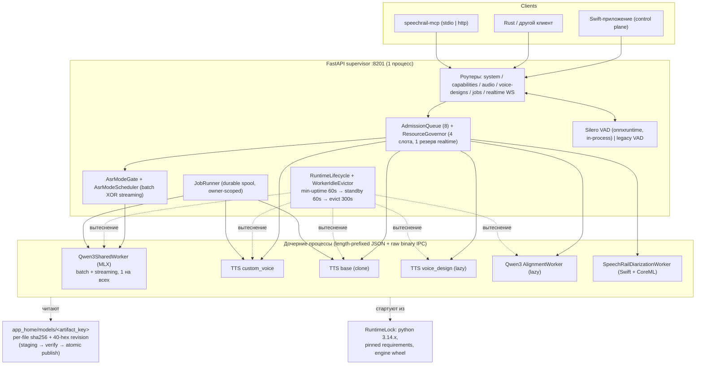

# C — SpeechRail: аудит локального речевого сервиса

Аудит по исходникам клона `github.com/hrygo/SpeechRail` @ `cdccc74084bc94f8c996b5b71a386455640ad1cb`
(далее — SHA `cdccc74`). Все permalink'и в разделе «Факты» указывают на этот SHA.
Дата аудита: 2026-10-25.

---

## Итог

1. **SpeechRail — это не «Ollama для речи», а «один Mac — один активный профиль ASR+TTS».**
   Модель в запросе (`model=`) не выбирает движок: она проверяется как alias к *единственному*
   сконфигурированному артефакту, иначе `400 model_not_found`. Смена модели — офлайн-транзакция
   CLI (`profile apply`), которая останавливает сервис, переключает селект, стартует и прогоняет
   smoke, с журналом откатов. (`src/speechrail/http/routes/audio.py#L757-L762`,
   `src/speechrail/compatibility/openai_realtime.py#L34-L46`,
   `src/speechrail/service/profile_switch.py`)

2. **Стек:** Python 3.14 (`requires-python >=3.14,<3.15`), FastAPI + uvicorn + pydantic v2,
   один ASGI-процесс; инференс — в дочерних Python-процессах с MLX; диаризация — отдельный
   Swift-бинарь (CoreML/FluidAudio); macOS-only (macOS 26+, Apple Silicon), MIT.
   (`pyproject.toml`, `src/speechrail/app.py#L261-L266`, `hatch_build.py#L47-L68`)

3. **Процессная модель — самая сильная часть проекта:** супервизор + до 6 типов дочерних
   процессов (1 общий ASR-worker на batch+streaming, до 3 TTS-worker'ов за capability-router,
   1 aligner-worker, Swift-диаризатор на сессию), length-prefixed JSON/binary IPC,
   раздельные read/write-локи, трёхступенчатое вытеснение (min-uptime → warm standby с trim
   памяти → cold evict), governor с резервом под realtime и бюджетом по объявленным байтам.

4. **Каталог моделей — образцовый по воспроизводимости, но крошечный по охвату:**
   12 артефактов, все — семейства Qwen3 (ASR 0.6B/1.7B, TTS 12Hz Base/CustomVoice/VoiceDesign,
   ForcedAligner). Ни Whisper, ни Parakeet, ни SenseVoice, ни отдельных VAD-моделей в каталоге.
   Каждый артефакт: per-file `sha256`+`size`, 40-hex revision, источник (ModelScope),
   явные `(tier, role) → artifact_key` биндинги, общий `runtime-lock` с пиннингом
   Python-зависимостей и wheel'а движка.

5. **Установка/обновление моделей — только оператором, никогда по запросу.** Скачивание
   стримом в `.staging` → проверка хэшей → атомарная публикация в `app_home/models/<key>`,
   реестр `state/model-preparations.json`, возможность внешнего корня через
   `config/model_locations.json`. **Команды удаления/GC моделей нет** — это прямой пробел
   относительно требований «установка/удаление/обновление/версии».

6. **Потоковость сделана строго и с явной ценой:** `/v1/realtime` — версионированный контракт
   (v7.1.0) с fail-closed на неизвестных полях, без legacy-переводов и без `/v2`. Но batch и
   streaming ASR **физически взаимоисключающи** на одном воркере (`AsrModeGate` → `backend_busy`),
   т.к. по решению автора «batch и streaming не работают одновременно».

7. **Диаризация — только анонимные метки в пределах сессии**, без эмбеддингов, без voiceprint-БД,
   без enrollment; требует отдельного CoreML-бандла Sortformer v2.1 (FP16) **и** aligner'а для
   атрибуции текста. Голосовых эмбеддингов как API нет вообще.

8. **Механизма расширения сторонними движками нет.** «Адаптер» = Python `Protocol` в
   `domain/ports.py` + ручная композиция в `build_app_services()`; нет entry points, нет
   реестра плагинов, IPC-словарь `kind` зашит под Qwen3. Добавление движка = правка кода
   супервизора.

9. **Зрелость: очень высокая культура инженерии при очень короткой истории и bus factor 1.**
   1483 коммита, один автор (`aaronwong1989@live.cn`, он же hrygo/黄飞虹) + 13 dependabot;
   август 2026 — 65, сентябрь — 955, октябрь — 390; 73 тега; v0.1.0 (2026-08-31) → v5.0.0
   (2026-10-24) за ~2 месяца. 312 тестовых файлов / ~115k строк тестов против ~71k строк
   исходников, coverage-gate 80 %, strict mypy, ruff, контрактные jsonschema-тесты.

10. **Вердикт: целиком — нет; отдельные решения — да, и они лучшие в выборке.**
    Забирать: модель репозитория артефактов (хэши+revision+явные биндинги), staging→verify→
    atomic publish, офлайн-инвариант `HF_HUB_OFFLINE`, трёхступенчатое вытеснение,
    governor с резервом под realtime, mode-gate на общий воркер, журнал транзакции профиля,
    `ServerInstanceLock` по порту, семантику launchd-агента. Не забирать: Python 3.14-only,
    Qwen3-only, один активный профиль, отсутствие per-request выбора модели, 250k строк
    SwiftUI в том же репозитории.

---

## Факты

### 1. Язык, стек, назначение

| Что | Значение | Доказательство |
|---|---|---|
| Язык рантайма | Python `>=3.14,<3.15`, mypy `python_version=3.14`, `target-version=py314` | `pyproject.toml` (`requires-python`, `[tool.mypy]`, `[tool.ruff]`) |
| Веб-стек | FastAPI ≥0.115, uvicorn[standard] ≥0.34, pydantic ≥2.10, pydantic-settings, httpx, websockets, python-multipart | `pyproject.toml` `dependencies` |
| Единственная жёсткая платформенная зависимость | `onnxruntime==1.31.0; sys_platform == 'darwin' and platform_machine == 'arm64'` | `pyproject.toml` |
| Версия / лицензия | 5.0.0, MIT, `Development Status :: 4 - Beta`, `Operating System :: MacOS` | `pyproject.toml`, `LICENSE` |
| Платформа | macOS 26+, Apple Silicon (бейдж `macOS 26+ Apple Silicon`), `Package.swift` диаризатора: `platforms: [.macOS(.v26)]` | `README.md`, `native/diarization/Package.swift#L4` |
| Назначение | «single-user local speech service for one Apple Silicon Mac», хостит ASR/TTS/диаризацию за одним локальным эндпоинтом; «не voice-agent platform» | `README.md` |
| Что НЕ делает | нет LLM, нет истории диалога, нет tool-calling, нет playback-политики | `README.md` (Boundaries) |
| Клиентские приложения | SwiftUI-приложение `macos/SpeechRailApp` (~409 файлов, ~250k строк Swift) — control plane, не грузит модели | `README.md`, подсчёт `git ls-files 'macos/**/*.swift'` |
| MCP | `speechrail-mcp`: stateless proxy (stdio по умолчанию, либо streamable-http 127.0.0.1:8202), ~17 инструментов (describe/transcribe/synthesize/preview_voice/create_voice/get_voice/design_voice/confirm_voice_design/validate_voice_design/publish_voice_design/clone_voice/validate_voice/delete_voice/create_job/get_job/list_jobs) | `pyproject.toml` `[project.scripts]`, `src/speechrail/mcp/server.py` |
| Объём | ~71 096 строк Python в `src/`, ~115 316 строк в `tests/`, 2252 строки в самом большом файле (`http/routes/audio.py`) | подсчёт `git ls-files` |

Композиционный корень: `create_app()` собирает `AppServices` и подключает шесть роутеров —
`src/speechrail/app.py#L261-L266`.

### 2. Управление общим сервисом (демон, launchd, CLI)

- **LaunchAgent**, label `com.speechrail`, `-m speechrail serve`, `RunAtLoad=true`,
  `KeepAlive={SuccessfulExit:false}`, `ThrottleInterval=10`, `ProcessType=Interactive`,
  stdout/stderr в файлы: `deploy/macos/com.speechrail.plist.example#L5-L24`.
- **Менеджер** (`LaunchAgentManager`) управляет только per-user агентом, без shell-интерполяции
  и без root; таймаут `launchctl` 15 с, throttle 10 с: `src/speechrail/service/launchd.py#L15-L17`.
- **CLI** (`argparse`, точка входа `speechrail = speechrail.__main__:main`):
  `serve`, `diagnose`, `setup`, `install --wheel [--enable] [--json]`,
  `profile {list,status,apply,rollback}`, `model {catalog,status,prepare,prepare-diarization}`,
  `agents {install,status,update,uninstall} --client codex`,
  `service {install,start,stop,enable,disable,restart,status,uninstall,preflight}`,
  `media {capabilities,export}`: `src/speechrail/cli.py#L147-L317`.
- **Раскладка** (`ServiceLayout`): `app_home = ~/Library/Application Support/SpeechRail`,
  `runtime/releases` + симлинк `runtime/current`, `config/.env` (0600), `models/`,
  `vendor/` (lock-keyed venv'ы), логи в `~/Library/Logs/SpeechRail`, plist в
  `~/Library/LaunchAgents/com.speechrail.plist`; все каталоги создаются с `0o700`:
  `src/speechrail/service/paths.py#L20-L95`.
- **Единственный экземпляр**: `ServerInstanceLock` — kernel `flock` по ключу `(uid, port)`,
  файл в TMPDIR, чтобы dev-checkout и managed-install не поднимали два процесса на одном порту:
  `src/speechrail/runtime/server_lock.py#L30-L45`, использование —
  `src/speechrail/cli.py#L92-L99`.
- **Сервис = один ASGI-процесс**: `uvicorn.run(create_app(settings), host, port, log_config=None)`,
  без `--workers`, без репликации моделей: `src/speechrail/cli.py#L88-L99`.

### 3. Установка и хранение моделей

**Каталог** (`src/speechrail/assets/model-catalog.json`, schema_version 2). 12 артефактов:

| key | family / variant | model_id | точность | размер файлов | revision (8) |
|---|---|---|---|---|---|
| `asr-0.6b-q8` | qwen3_asr / asr | `mlx-community/Qwen3-ASR-0.6B-8bit` | 8-bit, g64 | 1.01 GB | `54e4c713` |
| `asr-1.7b-q8` | qwen3_asr / asr | `mlx-community/Qwen3-ASR-1.7B-8bit` | 8-bit, g64 | 2.47 GB | `579e237c` |
| `asr-1.7b-bf16` | qwen3_asr / asr | `mlx-community/Qwen3-ASR-1.7B-bf16` | bf16 | 4.08 GB | `ef12a053` |
| `tts-0.6b-custom-q8` | qwen3_tts / custom_voice | `...Qwen3-TTS-12Hz-0.6B-CustomVoice-8bit` | 8-bit | 1.97 GB | `a04a567b` |
| `tts-0.6b-base-q8` | qwen3_tts / base | `...Qwen3-TTS-12Hz-0.6B-Base-8bit` | 8-bit | 1.99 GB | `191c7e69` |
| `tts-1.7b-custom-q8` | qwen3_tts / custom_voice | `...1.7B-CustomVoice-8bit` | 8-bit | 3.08 GB | `08b85452` |
| `tts-1.7b-base-q8` | qwen3_tts / base | `...1.7B-Base-8bit` | 8-bit | 3.10 GB | `73ae2cb5` |
| `tts-1.7b-custom-bf16` | qwen3_tts / custom_voice | `...1.7B-CustomVoice-bf16` | bf16 | 4.52 GB | `42f1b6f6` |
| `tts-1.7b-base-bf16` | qwen3_tts / base | `...1.7B-Base-bf16` | bf16 | 4.54 GB | `072137f0` |
| `tts-1.7b-design-bf16` | qwen3_tts / voice_design | `...1.7B-VoiceDesign-bf16` | bf16 | 4.52 GB | `8f4e5ac0` |
| `aligner-q8` | qwen3_forced_aligner / aligner | `...Qwen3-ForcedAligner-0.6B-8bit` | 8-bit | 1.28 GB | `998b617c` |
| `aligner-bf16` | qwen3_forced_aligner / aligner | `...Qwen3-ForcedAligner-0.6B-bf16` | bf16 | 1.84 GB | `b8ac37ca` |

Все источники — `provider: "modelscope"`. Размеры посчитаны мной как сумма `files[].size`.

**Схема манифеста** (`src/speechrail/config/model_catalog.py`):

- `ArtifactFile`: `path` (относительный, без `..`), `size`, `sha256` (ровно 64 hex) — `#L137-L155`.
- `QuantizationSpec`: ровно один из `bits` или `dtype` (взаимоисключающе, валидатор) — `#L157-L183`.
- `SourceLocation`: `provider`, `repository`, `revision` (ровно 40 hex) — `#L185-L198`.
- `ModelArtifact`: `key`, `model_id`, `revision` (40 hex), `family`, `variant`,
  `quantization`, `files[]`, `sources[]` + инварианты (обязательны `config.json` и
  `model.safetensors`, токенизатор, для TTS — codec `speech_tokenizer/`; источник обязан
  содержать каноническую revision) — `#L200-L263`.
- `RuntimeLock`: `python` (строго `3.14.x`), `asr_requirements`/`tts_requirements`
  (только `pkg==version[ --hash=sha256:...]`), `ffmpeg_artifact`, `file_hashes`,
  `engine_wheel` (filename/sha256/source_revision/patch_sha256/build_inputs_sha256) —
  `#L311-L360`.
- `ModelSpecBinding` `(tier, role) → artifact_key` — «явный биндинг, без вывода по имени» —
  `#L265-L273`.

**Три уровня (`fast` / `quality` / `reference`)** выбираются независимо для ASR и TTS:
`SelectionRecord{schema_version:2, asr_spec, tts_spec, auto, generation, runtime_lock_id}` —
`src/speechrail/service/profile_store.py#L33-L50`.

**Скачивание и публикация:**

- `ModelScopeDownloader` идёт напрямую в `https://modelscope.cn/api/v1/models/<repo>/repo`
  (`Revision`, `FilePath`), стримом по 1 MiB, без Hub-клиента — «чтобы 8 GB машине не нужен
  был второй полный снапшот на диске»: `src/speechrail/service/modelscope.py#L15-L80`.
- Верификация снапшота: симлинки и не-каталоги отвергаются, каждый файл проверяется по
  `safe_artifact_path` + хэш/размер: `src/speechrail/service/model_store.py#L580-L660`.
- Публикация: staging-каталог → verify → атомарная замена целевого `models/<artifact_key>`,
  с backup-путём и operation_id: `src/speechrail/service/model_store.py#L1548-L1560`.
- Состояния артефакта: `not_downloaded | verified | invalid`, integrity
  `verified | mismatch | not_checked`, location `app_home | external`:
  `src/speechrail/service/model_store.py#L44-L70`.
- Внешние корни (модели на другом диске) — `config/model_locations.json`, схема v1,
  запрет симлинков, `.staging` и вложенности в `app_home/models|diarization`:
  `src/speechrail/config/model_locations.py#L14-L78`.
- `prepare_spec_models()` / `prepare_selection_models()` — единственные входы подготовки:
  `src/speechrail/service/model_store.py#L1784`, `#L1821`.
- Реестр подготовок: `state/model-preparations.json`, schema_version 1 —
  `src/speechrail/service/model_store.py#L36-L38`, `#L977`.
- **Удаления/GC нет**: в CLI нет `model remove`; `shutil.rmtree` встречается только для
  staging/backup и релизов рантайма (`model_store.py#L228-L240`, `managed_install.py#L458`).

**Инвариант «никаких загрузок по запросу»** заявлен в ADR и подтверждается кодом: воркеры
стартуют с `HF_HUB_OFFLINE=1`, `TRANSFORMERS_OFFLINE=1`, `HF_DATASETS_OFFLINE=1`,
`PYTORCH_ENABLE_MPS_FALLBACK=0` — `src/speechrail/runtime/worker_process.py#L106-L128`;
`tts_allow_model_downloads` по умолчанию `false` — `src/speechrail/config/__init__.py`.

**Установка рантайма** (`managed_install.py`, `bootstrap.py`): wheel релиза ставится в
`runtime/releases/<...>` + симлинк `current`; отдельно собираются **два** vendor-venv'а
(`asr_python`, `tts_python`) по `RuntimeLock` и ffmpeg-бинарь из `imageio-ffmpeg==0.6.0`
с проверкой хэшей: `src/speechrail/service/bootstrap.py#L41-L90`.

### 4. REST/WebSocket API — полный перечень

43 пути / 52 операции в `contracts/openapi.yaml` + один WebSocket.
Формат ответа — везде единый error envelope `{error:{message,type,param,code}, request_id}`,
заголовок `x-request-id`, `x-speechrail-error-code` (`src/speechrail/app.py#L164-L230`).

**Системные**

| Метод | Путь | Формат / назначение |
|---|---|---|
| GET | `/health` | JSON: состояния подсистем (`asr/tts/streaming` + `realtime_vad` отдельно) |
| GET | `/readyz` | 200 если `asr_ready or tts_ready`, иначе 503 |
| GET | `/metrics` | Prometheus text |
| GET | `/v1/models` | JSON `{object:list,data:[...]}` — проекция активного профиля + alias'ы (`resolves_to`) |

**ASR (batch)**

| Метод | Путь | Формат |
|---|---|---|
| POST | `/v1/audio/transcriptions` | multipart: `file`, `model`, `language`, `languages[]`, `prompt`, `response_format` ∈ {json, verbose_json, text, srt, vtt, diarized_json}, `temperature`, `timestamp_granularities[]`, `stream`, `chunking_strategy[type]`, `include[]`, `keywords[]`, `known_speaker_names[]`, `known_speaker_references[]` |

Ограничения маршрута: `stream=true` разрешён **только** для диаризации; `chunking_strategy`
разрешён только для диаризации (`auto|server_vad`); `timestamp_granularities` требует
`verbose_json`; `diarized_json` требует `model=gpt-4o-transcribe-diarize`; `prompt` ≤ 2000
символов; `temperature` ∈ [0,2]; известные спикеры → `400 unsupported_parameter`
(`src/speechrail/http/routes/audio.py#L722-L900`).

**TTS**

| Метод | Путь | Формат |
|---|---|---|
| POST | `/v1/audio/speech` | JSON `{model, input, voice (строка или {id}), response_format ∈ {mp3,opus,aac,flac,wav,pcm}, speed}` + опциональные заголовки `SpeechRail-Expected-Voice-Revision`, `SpeechRail-Expected-Model-Revision`, `SpeechRail-Pronunciation-Set`, `SpeechRail-Receipt-Mode`, `SpeechRail-Purpose`, `SpeechRail-Latency-Budget-Ms`, `SpeechRail-Timing-Mode`, `SpeechRail-Language`, `SpeechRail-Seed`, `SpeechRail-Validation-Policy` → поток байт |
| POST | `/v1/voices/previews` | транзиентный VoiceDesign-сэмпл без регистрации голоса |

`src/speechrail/http/routes/audio.py#L177`, `#L1544-L1610`.

**Голоса и библиотека**

| Метод | Путь | Назначение |
|---|---|---|
| GET | `/v1/voices` | системные пресеты + кастомные |
| POST | `/v1/voices` (201) | создать кастомный голос из текстовой инструкции |
| GET | `/v1/voices/{voice_id}` | профиль голоса |
| PATCH | `/v1/voices/{voice_id}` | атомарное обновление метаданных |
| DELETE | `/v1/voices/{voice_id}` | удалить кастомный голос |
| POST | `/v1/voices/{voice_id}/quality-runs` | прогон оценки качества |
| GET | `/v1/voices/clone/prompts` | курированные скрипты для zero-shot клонирования |
| POST | `/v1/voices/clone` (201) | клонирование из референс-записи |
| POST | `/v1/voices/clone/validate` | валидация клона |
| GET | `/v1/speechrail/voices/clone/idempotency` | состояние операции по владению ключом |
| POST | `/v1/voices/bundles` / `POST /v1/voices/bundles/inspect` | импорт/инспекция `.srvoice`-архива |
| GET | `/v1/voices/{voice_id}/bundle` / `.../bundle/preview` | экспорт/превью бандла |
| GET | `/v1/speechrail/voices`, `/v1/speechrail/voices/{id}` | v2-проекция библиотеки |
| PATCH | `/v1/speechrail/voices/{voice_id}` | CAS-обновление (v2) |
| GET | `/v1/speechrail/voices/{voice_id}/revisions` | список неизменяемых ревизий |
| POST | `/v1/speechrail/voices/{voice_id}/rollback` | откат на не-revoked ревизию |
| POST | `/v1/speechrail/voices/{voice_id}/revisions/{revision}/revoke` | отзыв ревизии |
| POST | `/v1/speechrail/voices/{voice_id}/quality-runs` | качество (v2) |

**Voice design (prefix `/v1/voice-designs`)**

| Метод | Путь | Назначение |
|---|---|---|
| POST | `` (201) | создать кандидата (идемпотентно) |
| GET | `` | список кандидатов |
| GET | `/{candidate_id}` | кандидат |
| GET | `/{candidate_id}/audio` | референс-аудио |
| GET | `/{candidate_id}/validations/{validation_id}/audio` | аудио валидации |
| POST | `/{candidate_id}/confirm` | подтвердить |
| POST | `/{candidate_id}/validate` | валидировать |
| POST | `/{candidate_id}/publish` (201) | опубликовать в библиотеку |
| POST | `/{candidate_id}/cancel` | отменить |

`src/speechrail/http/routes/voice_designs.py#L461-L1480`.

**Произношение, приёмки, задания, возможности**

| Метод | Путь | Назначение |
|---|---|---|
| GET/PUT/DELETE | `/v1/speechrail/pronunciation-sets[/{set_id}]` | версионируемые наборы произношения |
| GET | `/v1/speechrail/pronunciation-sets/{set_id}/revisions/{revision}` | ревизия |
| POST | `/v1/speechrail/pronunciation-sets/{set_id}/revisions/{revision}/revoke` | отзыв |
| GET | `/v1/speechrail/audio/receipts/{receipt_id}` | evidence рендера (без аудио/текста) |
| GET | `/v1/speechrail/audio/receipts/by-request/{source_request_id}` | то же по request id |
| GET | `/v1/speechrail/audio/timings/{timing_id}` | метаданные тайминга TTS |
| POST | `/v1/jobs` (202) | durable job: `{kind: speech|transcription, params:{...}}` |
| GET | `/v1/jobs?limit=` | список (owner-scoped) |
| GET/DELETE | `/v1/jobs/{job_id}` | статус / удаление |
| GET | `/v1/jobs/{job_id}/result` | результат |
| GET | `/v1/speechrail/capabilities` | `effective_capabilities_v1` — один согласованный снимок моделей/голосов/доменов параметров; чтение не стартует воркер |

Параметры job валидируются одной чистой функцией, общей для REST и MCP:
`src/speechrail/domain/job_request.py#L17-L45`.

**WebSocket `/v1/realtime`** (контракт v7.1.0, `contracts/realtime-openai.md`):

- Хендшейк: `?model=` (alias к активной модели), при `SPEECHRAIL_API_KEY` — Bearer;
  неготовый бэкенд → close 1013, неверный ключ → 1008, неизвестная модель → error + close:
  `src/speechrail/http/routes/realtime_openai.py#L73-L137`.
- Wire: 24 kHz mono PCM16 LE; ядро ASR — 16 kHz с непрерывным stateful-ресемплером;
  другие частоты/кодеки отвергаются до первого аудио (`unsupported_audio_format`):
  `src/speechrail/compatibility/openai_realtime.py#L51-L53`, контракт §2.
- Клиентские события: `session.update`, `input_audio_buffer.append|commit|clear`,
  `speechrail.diarization.finish`, `speechrail.tts.start|append_text|finish_text|cancel|audio_ack`.
- Серверные: `session.created|updated`, `speechrail.transcription.segment_closed`,
  `conversation.item.input_audio_transcription.delta|completed|failed`,
  `speechrail.transcription.hypothesis`, `speechrail.input_audio_buffer.committed`,
  `speechrail.alignment.done|failed`, `speechrail.diarization.updated|done|failed`.
- Явно НЕ поддерживается: `speechrail.tts.create`, `transcription_session.update`,
  conversation/response-события, `input_audio_buffer.speech_started/stopped`,
  официальный непустой `turn_detection` (только `null` или `"manual"`); серверный VAD —
  через `session.speechrail.endpointing={"mode":"server_vad"}`.
- `sequence` начинается с 0 и инкрементируется до отправки (комментарий в коде объясняет,
  почему порядок именно такой): `src/speechrail/http/routes/realtime_openai.py#L92-L118`.

### 5. Управление процессами и ресурсами

**Топология** (проверено в `build_app_services`):

```
FastAPI (1 процесс, 1 ASGI worker)
├── Qwen3SharedWorker  → 1 дочерний Python (MLX) — ОБЩИЙ для batch и streaming ASR
├── Qwen3TtsCapabilityRouter → до 3 дочерних Python:
│     tts_custom_voice (системные голоса), tts_base (клонирование), voice_design (по запросу)
├── Qwen3AlignmentWorker → 1 дочерний Python (ForcedAligner), стартует по требованию
├── CoreMLSortformerEngine → Swift-бинарь, по одному процессу на активную сессию
├── MeetingDiarizationEngine (опционально) → тот же Swift-бинарь, другой бандл
└── JobRunner (in-process asyncio-задача) + WorkerIdleEvictor
```

`src/speechrail/application/services.py#L662-L1090` (`shared_owner` — `#L692`, TTS-router —
`#L789`, governor — `#L887`, CoreML-диаризация — `#L900`, aligner — `#L916`,
evictor — `#L1005`, lifecycle — `#L1052`).

**IPC-контракт:** length-prefixed фреймы; JSON-заголовок + опциональный raw binary payload
(без Base64 для PCM); `MAX_FRAME_BYTES = 128 MiB` (обоснован 3600 с × 16 kHz PCM16);
`PROTOCOL_VERSION = 1`: `src/speechrail/runtime/worker_protocol.py#L1-L40`.

**Транспорт:** `AsyncFramedWorkerProcess` с **раздельными** read/write-локами —
читатель, припаркованный на `receive()` в realtime-цикле, не блокирует writer;
`exchange()` берёт оба лока для атомарной пары запрос/ответ; кольцевой stderr-буфер 16 KiB
для диагностики без утечки текста ошибок: `src/speechrail/runtime/worker_process.py#L130-L263`.

**Протокол операций воркера** (`src/speechrail/backends/qwen3_worker.py#L349-L1000`):
`window.decode`, `window.close`, `transcribe`, `session.open`, `audio.append`, `flush`,
`commit`, `cancel` — словарь зашит под Qwen3, не обобщён.

**Загрузка/выгрузка и лимиты памяти:**

- Три состояния воркера: `active → warm_standby (trim_memory/release_cache) → cold_evicted`;
  ошибка освобождения → `reclamation_failed` и изоляция лейна:
  `src/speechrail/runtime/worker_lease.py#L24-L40`, `#L216-L260`.
- Тайминги по умолчанию: `worker_min_uptime_seconds=60` (анти-thrash),
  `worker_warm_standby_timeout_seconds=60`, `worker_idle_timeout_seconds=300`,
  отдельные TTL для design-лейна: `src/speechrail/config/__init__.py#L116-L119`.
- Ожидание/вытеснение не оставляет «висящих» лизингов: `idle()` держит admission-lock
  на всё время close, а `_cold_evict` фиксирует исход внутри cleanup-задачи
  (устойчиво к отмене ожидающего): `src/speechrail/runtime/worker_lease.py#L60-L90`, `#L218-L250`.
- **Бюджет памяти:** `budget_for_hardware(total) = max(4 GiB, total//2)`, минимум 8 GiB
  физической памяти, иначе `ValueError`; тяжёлые оси (ASR/TTS/диаризация) перекрываются
  только если сумма *объявленных* пиков укладывается в бюджет, иначе — fail-closed сериализация:
  `src/speechrail/runtime/model_budget.py#L173-L231`.
- **Governor:** `total_capacity=4`, `realtime_reserved_capacity=1`,
  `max_pending_per_class=8`, `batch_aging_seconds=30`; batch может занять только
  нерезервированную ёмкость, realtime никогда не ждёт batch, TTS-лейны сериализуются по
  `resource_key`: `src/speechrail/domain/resource_limits.py`, `src/speechrail/runtime/resource_governor.py#L104-L200`.
- **AdmissionQueue**: token-queue фиксированной ёмкости (`max_queue_size=8`), отказ
  немедленный и атомарный, дедлайн через `asyncio.timeout`:
  `src/speechrail/runtime/admission.py#L16-L37`.
- **ASR mode gate**: batch и streaming не могут работать одновременно на общем воркере;
  конфликт → `AsrModeBusy` (`busy_reason=asr_mode_conflict`, `retryable=true`); поверх —
  `AsrModeScheduler` с FIFO + aging (30 с), чтобы batch не голодал при потоке streaming:
  `src/speechrail/runtime/asr_mode.py#L44-L120`, `#L120-L210`.
- **Порядок старта/остановки:** recovery джобов → ASR → TTS → JobRunner → Evictor;
  alignment — по требованию; shutdown пытается закрыть каждого владельца и сообщает
  агрегированную ошибку (`ExceptionGroup`): `src/speechrail/application/lifecycle.py#L40-L70`,
  `#L150-L210`.

### 6. Одновременные клиенты

- Несколько независимых REST-клиентов: да, ограничены `AdmissionQueue` (8) + governor (4 слота).
- Realtime: `realtime_max_sessions` по умолчанию **3** (диапазон 1–8);
  каждая сессия — свой `session_id`, `sequence`, epoch:
  `src/speechrail/config/__init__.py#L129`, `src/speechrail/backends/qwen3_shared.py#L20-L22`
  (`MAX_SESSIONS = 8`, `SESSION_QUEUE_MAXSIZE = 64`).
- Один общий ASR-воркер на всех: параллельные streaming-сессии делят один процесс и один
  MLX-контекст; параллельный batch в это время запрещён (mode gate).
- TTS: разные lane'ы (`custom_voice` / `base` / `voice_design`) могут работать
  одновременно, внутри одного lane — строго последовательно (worker lock).
- Явное ограничение продукта: «One service, one ASGI worker… Contention returns
  `backend_busy` by design» (`README.md`, Boundaries).

### 7. Явный выбор модели в запросе — НЕТ

- `POST /v1/audio/transcriptions`: `model` валидируется против
  `{settings.model_id} ∪ compatibility_model_ids`; иначе `400 model_not_found`.
- Все официальные alias'ы (`whisper-1`, `gpt-4o-transcribe`, `gpt-4o-mini-transcribe`,
  `gpt-transcribe`, `gpt-live-transcribe`, `gpt-4o-transcribe-diarize`) сходятся в
  **одну** строку `speechrail/qwen3-asr-1.7b`; TTS-алиасы (`tts-1`, `tts-1-hd`,
  `gpt-4o-mini-tts`) — в `speechrail/qwen3-tts`:
  `src/speechrail/compatibility/openai_realtime.py#L34-L46`.
- `gpt-4o-transcribe-diarize` — не отдельная модель, а переключатель диаризации
  (требует готового профиля диаризации и aligner'а).
- Смена модели: `speechrail profile apply --asr-spec --tts-spec` (офлайн, с drain →
  stop → switch → start → smoke → commit и откатом):
  `src/speechrail/service/profile_store.py#L20-L32` (машина состояний
  `PREPARING→VERIFIED→STOPPING→SWITCHING→STARTING→SMOKING→COMMITTED|ROLLING_BACK`),
  `src/speechrail/service/profile_switch.py#L100-L160`.
- Публичного management API для смены модели нет — намеренно (ADR-0011 §6: «не добавлять
  публичный management API / web-панель / демон»).

### 8. Поддерживаемые ASR-движки и модели

| Роль | Движок | Модели |
|---|---|---|
| Batch ASR | Qwen3-ASR через `mlx_qwen3_asr` в дочернем процессе | `asr-0.6b-q8`, `asr-1.7b-q8`, `asr-1.7b-bf16` |
| Streaming ASR | тот же движок, streaming-режим (`realtime_asr_backend = disabled|native`) | тот же артефакт, что и batch |
| Alignment | Qwen3-ForcedAligner | `aligner-q8`, `aligner-bf16` |
| TTS | Qwen3-TTS 12 Hz | Base / CustomVoice / VoiceDesign (0.6B и 1.7B, 8-bit и bf16) |
| VAD | Silero VAD ONNX (v4/v5/v6-схемы) + legacy энергетический VAD | Silero pinned commit `867c2aa692646a1f1de3e94a15c9dd9f614c0acb`, sha256 `1a153a22…88e3`, ~2.3 MB |
| Диаризация | CoreML Sortformer (FluidAudio) или `meeting_dynamic` | `SortformerNvidiaLow_v2.1.mlmodelc` FP16, FluidAudio @ `5c19d5e1…` |

Whisper, Parakeet, SenseVoice, NeMo, ONNX-ASR — отсутствуют. `whisper-1` — только alias
(см. §7). Silero грузится in-process через `onnxruntime` (`src/speechrail/backends/neural_vad.py#L1-L45`),
legacy VAD — чистый numpy (`src/speechrail/backends/vad.py#L1-L40`); pinned-загрузка Silero —
`src/speechrail/service/vad_model.py#L18-L30`.

### 9. Диаризация

- Два бэкенда: `sortformer` (CoreML, FP16) и `meeting_dynamic` (CoreML-эмбеддинги + FBank +
  `plda-parameters.json`, требует аутентифицированной политики с `certified_max_speakers` 1–4).
- Swift-воркер `SpeechRailDiarizationWorker` общается по собственному пакетному протоколу
  (8-байтовый префикс + header + payload) через stdin/stdout:
  `native/diarization/Sources/SpeechRailDiarizationWorker/main.swift#L1-L55`.
- Python-адаптер не содержит модели: `MODEL_REVISION`, `FLUIDAUDIO_COMMIT` и per-file
  sha256 для 11 файлов `.mlmodelc` захардкожены и проверяются перед запуском:
  `src/speechrail/backends/diarization/coreml.py#L24-L60`.
- Зависимость от FluidAudio закреплена по ревизии: `native/diarization/Package.swift#L9-L14`.
- Атрибуция текста требует отдельного aligner'а: без него
  `diarization_alignment_not_configured` (`src/speechrail/application/services.py#L554-L580`).
- Только анонимные session-scoped метки; известные спикеры (`known_speaker_names`,
  `known_speaker_references`) отвергаются `400 unsupported_parameter`; voiceprint-БД,
  enrollment и кросс-сессионная идентичность отсутствуют (`README.md`, Boundaries).
- Голосовых эмбеддингов как API нет: grep `embedding` по `http/routes/*` и
  `contracts/openapi.yaml` не даёт совпадений.

### 10. Потоковые сессии

- `/v1/realtime` — единственный потоковый вход (старый `/asr` и `/v2/realtime` удалены,
  ADR-0008/0009).
- Сегментация: `preview_interval_ms` (100–5000, деф. 1000), `max_segment_ms` (1000–30000,
  деф. 20000), `finalization ∈ {full_segment, streaming_finalize}`, `rollback_tokens` (0–32,
  деф. 5), `final_deadline_ms`; эффективный лимит = min(запроса, ресурсов, возможностей,
  декодера) — **без тихого клампа**, невалидное отвергается.
- VAD: серверный endpointing отдельно от официального `turn_detection`; Silero даёт
  per-frame probability с гистерезисом (нижний `stop_threshold = threshold - 0.15`),
  legacy-энергетика требует 3 подряд подтверждающих фрейма:
  `src/speechrail/backends/vad.py#L14-L40`, контракт §3.
- Барьер завершения: `input_audio_buffer.commit` + `speechrail.request_receipt` →
  `speechrail.input_audio_buffer.committed{accepted_samples}`; максимум 16 незавершённых
  барьеров на соединение, затем `queue_full`.
- TTS в realtime — инкрементальный: `speechrail.tts.start|append_text|finish_text|audio_ack`
  с явным окном потребления PCM (`audio_window_bytes`), ACK по `sample_offset`;
  отмена приоритетнее аудио и терминального состояния.

### 11. Зависимость от Python

- Рантайм-процесс — Python; **вся** оркестрация, HTTP, валидация, планирование, метрики — Python.
- Инференс ASR/TTS — тоже Python-процессы (MLX через `mlx-qwen3-asr`), но в **отдельных**
  vendor-venv'ах с пиннингом версий из `RuntimeLock`, изолированных от host-Python.
- Требование `Python 3.14.x` жёсткое (валидатор `re.fullmatch(r"3\.14\.\d+")`).
- Диаризация — единственная часть без Python (Swift + CoreML).
- Следствие: клиент на Swift/Rust обязан либо запускать этот Python-сервис, либо
  переиспользовать только идеи, не код.

### 12. Механизм расширения сторонними движками

**Плагинной системы нет.** Есть:

1. `Protocol`-порты в `src/speechrail/domain/ports.py`: `BatchTranscriber`,
   `StreamingBatchTranscriber`, `StreamingTranscriber`, `SpeechSynthesizer`,
   `RealtimeAsrSession`/`RealtimeAsrFactory`, `DiarizationEngine`, `WindowAsrFactory`,
   плюс Pydantic-модели запросов/ответов (`TranscriptionRequest`, `SpeechRequest`,
   `AudioChunk`, `StreamingAsrEvent`). Docstring: «Typed, vendor-neutral inference ports».
2. Композиция в `build_app_services()` — ручной `if`/`is not None` по настройкам.
3. Инъекция через `AppOverrides` (`transcribe`, `batch_transcriber`, `realtime_asr_factory`,
   `diarization_engine`, `tts_synthesizer`, `voice_store`, `job_repository`,
   `job_processor`) — это тестовый/встраиваемый seam, не публичный плагин-контракт.
4. Версионированный IPC (`PROTOCOL_VERSION = 1`) — контракт между супервизором и *своими*
   воркерами, но словарь операций (`kind`) Qwen3-специфичен.

Вывод: сторонний движок можно подключить только форком и правкой Python-кода; декларативного
реестра движков (как в speech-swift) или entry-point-механизма нет.

### 13. Активность, зрелость, тесты

| Метрика | Значение |
|---|---|
| Всего коммитов | 1483 |
| Авторы | `aaronwong1989@live.cn` — 1470, dependabot — 13 (по `rev-list --author`) |
| Коммиты по месяцам | 2026-08: 65, 2026-09: 955, 2026-10: 390 |
| Теги | 73; `v0.1.0` (2026-08-31) → `v5.0.0` (2026-10-24) |
| `CHANGELOG.md` | 141 KB, самая ранняя запись `[0.1.0] - 2026-08-31` |
| Тестовые файлы | 312 `tests/*.py` (+9 вложенных), ~115 316 строк |
| Coverage gate | `fail_under = 80`, branch coverage |
| Статический анализ | ruff (E,W,F,I,N,UP,B,A,C4,SIM,ASYNC,RUF,PTH,RET), mypy `strict=true`, `platform="darwin"` |
| CI | GitHub Actions: ubuntu-24.04 (python-гейт), macos-26 (сборка wheel), Swift-гейт для app, change-scope классификация диффа, `uv` 0.12.13, действия запинены по SHA |
| Контрактные тесты | `jsonschema` против `contracts/*.schema.json`, `tests/openai-sdk-node/` (реальный `openai` SDK), `tests/mcp/` |
| Документация | 455 `.md`: 31 architecture, 24 ADR (`docs/decisions`), 20 audits, 38 implementation, 18 developers, 14 users |

Оценка зрелости `[INFERENCE]`: инженерная дисциплина выше среднего для проекта такого
возраста (ADR на каждое решение, контракт как единственный источник истины, fail-closed
по умолчанию, отдельные «boundaries»-документы), но историческая зрелость низкая:
2 месяца, 5 мажорных версий, единственный автор, огромная кодовая база (250k Swift + 71k Python).

### 14. Схема архитектуры (текстом / mermaid)



---

## Ограничения и риски

### Продуктовые ограничения (заявлены намеренно, но ломают наши требования)

1. **Нет выбора модели на запрос.** Один активный профиль на роль. Для «Ollama для речи»
   это блокер: клиент не может сказать «эту реплику — в 0.6B, эту — в 1.7B bf16».
2. **Нет голосовых эмбеддингов.** Ни API, ни порта, ни модели в каталоге.
   Требование «голосовые эмбеддинги» не покрыто вообще.
3. **Batch и streaming ASR взаимоисключающи.** Явное продуктовое решение («пользователь
   сказал, что одновременно не работают»), реализованное как `AsrModeGate`. Для
   универсального runtime это неприемлемо: два клиента (диктовка + встреча) получат `backend_busy`.
4. **Нет удаления/GC моделей.** Только подготовка. Диск будет расти монотонно.
5. **Диаризация недоступна без двух отдельных артефактов** (CoreML-бандл + aligner) и
   без Swift-бинаря, собранного при установке wheel'а.
6. **Мультиязычность каталога:** `ModelSpec.languages = frozenset({"zh","en"})` —
   захардкожено для всех ASR-спеков (`src/speechrail/domain/model_spec.py`, `registry_from_catalog`).
   Русский в этой модели formally не заявлен (хотя Qwen3-ASR его поддерживает — это
   утверждение о коде, не о качестве).

### Технические риски

7. **Python 3.14-only + macOS 26-only** — обе платформы bleeding edge на дату аудита.
   Любая попытка встроить это в существующий продукт потребует ровно этой связки.
8. **Установка тянет из сети:** vendor-venv'ы собираются по `RuntimeLock` (PyPI),
   модели — с ModelScope (китайский хостинг; доступность/лицензии артефактов не проверял).
9. **`ModelScopeDownloader` без резюмирования:** стрим с начала файла, до 3 ретраев
   (`_MAX_RETRIES = 3`), без range-запросов — многогигабайтные файлы при обрыве
   перекачиваются целиком.
10. **Swift-бинарь диаризации не объявлен как product** в `Package.swift`
    (product только `SpeechRailDiarizationGlobalProbe`), а `hatch_build.py` ждёт
    `.build/release/SpeechRailDiarizationWorker` после `swift build`.
    `[INFERENCE]` это хрупкое место сборки, зависящее от того, что `swift build` собирает
    target'ы вне products.
11. **Bus factor 1:** 1470 из 1483 коммитов — один автор; 73 тега за 2 месяца, 5 мажорных
    версий. Внешних контрибьюторов нет.
12. **Размер и связность:** 250k строк SwiftUI в том же репозитории, что и рантайм;
    продуктовые фичи (audiobook workshop, teleprompter, dubbing desk) живут рядом с
    сервисным ядром. Выделить ядро можно, но это работа.
13. **Язык документации:** значительная часть ADR/архитектуры и все docstring'и
    в доменных модулях — по-китайски. Для команды это реальные затраты на поддержку.
14. **`/metrics` и rollup** — Prometheus + собственный interval-rollup с retention;
    полезно, но добавляет поверхность.
15. **Лицензии артефактов не проверены** (сам SpeechRail — MIT): лицензии Qwen3-ASR/TTS
    весов, Sortformer CoreML-бандла и FluidAudio требуют отдельной проверки.

### Риски дизайна, которые стоит знать при заимствовании

16. `WorkerIdleEvictor` при `reclamation_failed` **изолирует лейн навсегда** до перезапуска
    процесса (`governor.quarantine_tts_lane`, `GovernorLaneIsolatedError`) — безопасно, но
    означает «после неудачного close сервис деградирует до рестарта».
17. Дефолт `realtime_max_sessions = 3` при одном общем воркере: сессии делят один
    MLX-контекст, конкурентность ограничена не столько памятью, сколько моделью.
18. Профиль-switch **останавливает сервис** — окно недоступности гарантировано
    (ADR-0011 §5: «принимаем видимое короткое окно недоступности»).

---

## Выводы для Runtime

### Вердикт

**Целиком — нет.** SpeechRail — это законченный *продукт* под одну машину, один профиль и
одно семейство моделей (Qwen3/MLX), с Python 3.14 и macOS 26 в качестве жёстких рамок.
Его публичный контракт ([OI]-совместимость + собственный realtime v7.1.0) и его
ограничения (batch XOR streaming, отсутствие эмбеддингов, отсутствие per-request выбора
модели) прямо противоречат целям универсального локального Speech Runtime.

**Отдельные решения — да, и они сильнейшие в выборке.** Ниже — что именно забирать.

### Брать: модель данных каталога и воспроизводимость

1. **`ModelArtifact` = key + model_id + 40-hex revision + family/variant + quantization +
   per-file `{path,size,sha256}` + sources.** Это ровно тот уровень строгости, которого
   не хватает «скачай с HF по имени». Хэш на каждый файл (а не только на итоговый архив)
   даёт частичную перепроверку и точную диагностику.
2. **Явные биндинги `(tier, role) → artifact_key` вместо вывода из имени каталога.**
   Комментарий в коде прямо про это: «Read explicit selection identity; never infer identity
   from a directory name». Для нашего runtime это означает: каталог моделей — данные,
   а не соглашение об именах.
3. **`RuntimeLock` отдельно от артефактов:** Python-версия, точные `pkg==version --hash`,
   хэши ffmpeg, provenance wheel'а движка. Позволяет ответить «какие веса + какой код»
   одним идентификатором. Переносить стоит как есть, заменив Python на «версию адаптера».
4. **Единственный способ описать точность:** либо `bits`, либо `dtype`, взаимоисключающе.
   Мелочь, но убирает класс UI-багов «сколько бит у этой модели».

### Брать: жизненный цикл установки модели

5. **staging → verify → atomic publish** с backup и `operation_id`, плюс реестр
   `model-preparations.json`. Даёт идемпотентность и восстановление после обрыва.
   **Дополнить тем, чего у SpeechRail нет: `remove`, `gc`, `verify-all`, `pin/upgrade`.**
6. **Внешние корни моделей** (`model_locations.json`, схема v1, запрет симлинков и
   вложенности в managed-каталог) — дешёвый способ поддержать внешние SSD.
7. **Офлайн-инвариант на пути запроса:** воркеры стартуют с `HF_HUB_OFFLINE=1` и
   `PYTORCH_ENABLE_MPS_FALLBACK=0`, allowlist переменных окружения. Загрузка модели —
   только явная операторская операция. Это ровно то, что нужно «Ollama-подобному» сервису:
   **pull — да, implicit download во время inference — нет.**

### Брать: процессная модель и ресурсы

8. **Один процесс-владелец на модель-роль**, а не «модель в процессе сервера».
   Позволяет выгружать/перезагружать веса без потери HTTP-состояния и изолирует падения
   движка. Для нашей задачи это ключ к «переиспользованию весов между клиентами»:
   веса живут в воркере, клиенты подключаются к сервису.
9. **Трёхступенчатое вытеснение** (`min_uptime` → `warm_standby` c `trim_memory` → `cold_evict`)
   с раздельными TTL на лейн. Это лучше бинарного «загружен/не загружен»: даёт
   «минимальные накладные расходы в простое» без штрафа за холодный старт при всплеске.
   Обязательно переносить вместе с анти-thrash guard'ом (min_uptime).
10. **`reclamation_failed` как отдельное состояние + изоляция лейна.** Честная модель:
    если процесс не подтвердил освобождение памяти, лейн не переиспользуется. Учит тому,
    чего обычно не делают: `close()` не считается успешным, пока `alive/ready` не стали false.
11. **Governor с резервом под realtime и FIFO+aging для batch.** Отсутствие преемпции
    уже запущенной работы + гарантированный слот для realtime — правильный компромисс для
    локального сервиса. `resource_key` для сериализации по lane — дешёвый способ не
    дублировать модели.
12. **Бюджет по объявленным байтам, fail-closed при неизвестном пике.** Формула
    `max(4 GiB, RAM/2)` и «неизвестно → сериализуем» — хороший дефолт для чужого железа.
13. **`ServerInstanceLock` по `(uid, port)`** — тривиально и предотвращает класс
    «два сервиса на одном порту после смены app_home».

### Брать: контракт и наблюдаемость

14. **Единый согласованный снимок возможностей** (`effective_capabilities_v1`): модели +
    голоса + домены параметров, чтение не стартует воркер и не делает инференс.
    Для мультидвижкового runtime это обязательный элемент: клиент должен узнавать
    «что сейчас реально обслуживается» без побочных эффектов.
15. **Fail-closed на неизвестных полях и отсутствие legacy-переводов.** Явный отказ от
    «тихой совместимости» (нет `/v2`, нет двойного протокола, неизвестное поле — ошибка)
    сильно упрощает контракт. Стоит скопировать как принцип.
16. **Барьер завершения ввода** (`request_receipt` → `committed{accepted_samples}`) и
    инвариант «ровно одно терминальное состояние на utterance». Это то, на чём обычно
    ломаются интеграции диктовки; решение проверяемое и дешёвое.
17. **Раздельные read/write-локи в IPC** с объяснением, почему один лок дедлочит
    (читатель припаркован на `readexactly`, writer не может отправить `append`).
    Готовый рецепт для любого «стриминг + управляющие команды по одному каналу».

### Брать: операционная обвязка

18. **launchd-семантика:** `RunAtLoad`, `KeepAlive.SuccessfulExit=false`,
    `ThrottleInterval=10`, `ProcessType=Interactive`, логи в файлы. Для macOS-десктопа
    это правильный минимум; в нашем случае стоит добавить `ProcessType=Background`
    или `Adaptive` для «тихого» простоя.
19. **Транзакция переключения профиля** (`PREPARING→…→COMMITTED`, журнал, один откат,
    smoke через публичный API). Даже если мы не будем останавливать сервис, машина
    состояний и «smoke перед commit» переносимы на горячую смену модели.
20. **Контрактные тесты против `openapi.yaml` + реального официального SDK** —
    дешёвая защита от дрейфа.

### Не брать

- **Python 3.14 + FastAPI как ядро** для сервиса, который должен жить годами на разных
  машинах: связка «3.14-only + macOS 26-only» — это не архитектурное решение, а срез момента.
- **Один активный профиль** и `profile apply` как единственный способ смены модели.
- **`AsrModeGate`** (batch XOR streaming) — прямое нарушение требования «одновременные
  независимые сессии».
- **Qwen3-only словарь IPC** (`kind: transcribe|session.open|…`) — нужен нейтральный
  контракт «подготовить/подать PCM/получить события/закрыть», а специфику движка держать
  в адаптере.
- **250k строк SwiftUI** рядом с рантаймом.
- **Отсутствие удаления моделей.**

### Как интегрировать (эскиз, `[INFERENCE]`)

```
runtime/
  catalog/            # артефакты: key, revision, per-file sha256, sources, capabilities
  store/              # staging → verify → publish → registry; remove/gc/upgrade
  supervisor/         # владелец процессов; 1 процесс на (модель, роль); IPC нейтральный
  residency/          # min_uptime → standby(trim) → evict; reclamation_failed
  admission/          # realtime-резерв, FIFO+aging, budget по объявленным байтам
  adapters/           # coreml | mlx | onnx | внешний процесс; публичный контракт адаптера
  api/                # REST + WS; model в запросе = ЯВНЫЙ выбор артефакта, не alias
```

Ключевое отличие от SpeechRail: `model` в запросе выбирает **артефакт из каталога**,
супервизор поднимает/переиспользует соответствующий воркер, residency-политика решает,
когда его выгрузить. Именно этот слой SpeechRail заменяет на «один профиль + офлайн-переключение».

---

## Неизвестные / что измерить

### Не удалось подтвердить

1. **Реальное качество и скорость на русской речи с английской IT-терминологией.**
   В репозитории есть `examples/perf`, `tools/probe_*`, `docs/audits`, но конкретных цифр
   WER/latency для ru+en я не нашёл; заявления «quality gate» относятся к zh/en и к
   собственным сценариям автора. Никаких бенчмарков я не воспроизводил.
2. **Лицензии весов и сторонних зависимостей:** Qwen3-ASR/TTS (ModelScope), CoreML-бандл
   Sortformer, FluidAudio (`5c19d5e1…`), `mlx-qwen3-asr`. Не проверял.
3. **Почему история git начинается 2026-08-20-х, а `CHANGELOG` — с 0.1.0 (2026-08-31):**
   даты выглядят согласованно, но 1483 коммита за ~8 недель при 250k+71k строк — либо
   экстремальная генеративная разработка, либо переписанная история. Проверить нельзя.
4. **Работает ли сборка wheel'а диаризатора** при том, что `SpeechRailDiarizationWorker`
   не объявлен product'ом (см. риск 10). Требует прогона `swift build` на macOS 26.
5. **Поведение под двумя одновременными realtime-клиентами + batch** на реальном железе:
   код говорит «batch получит `backend_busy`», но фактическая деградация латентности
   не измерена.
6. **Точные цифры памяти** для каждого профиля: `declared_*_bytes` в настройках — это
   объявления, а не измерения; фактические пики не подтверждены.
7. **Есть ли скрытая поддержка русского** в Qwen3-ASR (в коде `languages={"zh","en"}` —
   это метаданные спека, а не тест качества).

### Что нужно измерить перед решениями

| Измерение | Зачем |
|---|---|
| WER/CER ru+en-IT на своём корпусе для Qwen3-ASR 0.6B/1.7B (q8/bf16) | понять, тянет ли Qwen3 вообще нашу языковую задачу; без этого выбор движка не обоснован |
| RTF и first-token latency для тех же конфигураций на M1/M2/M3/M4 | оценить, реальна ли потоковость на целевом железе |
| RSS/footprint воркера ASR и TTS по профилям | заменить «объявленные» байты на измеренные для budget-политики |
| Время cold start (load) и warm standby (trim) для каждого артефакта | настроить `min_uptime`/`standby`/`evict` под реальность |
| Поведение при двух realtime-сессиях + batch на одном воркере | проверить, нужен ли нам вообще mode-gate или достаточно очереди |
| Стоимость простоя: RSS супервизора без воркеров | требование «минимальные накладные расходы в простое» |
| Качество диаризации Sortformer v2.1 на русских встречах (DER, 2–4 спикера) | решить, брать ли CoreML-бандл или другой движок |
| Сравнение `staging→publish` на 4.5 GB артефакте с обрывом сети | проверить, нужен ли нам resumable download (у SpeechRail его нет) |

---

## Источники

### Код SpeechRail (sha `cdccc74084bc94f8c996b5b71a386455640ad1cb`)

- `pyproject.toml` — https://github.com/hrygo/SpeechRail/blob/cdccc74084bc94f8c996b5b71a386455640ad1cb/pyproject.toml
- `src/speechrail/app.py` — https://github.com/hrygo/SpeechRail/blob/cdccc74084bc94f8c996b5b71a386455640ad1cb/src/speechrail/app.py#L261-L266
- `src/speechrail/cli.py` — https://github.com/hrygo/SpeechRail/blob/cdccc74084bc94f8c996b5b71a386455640ad1cb/src/speechrail/cli.py#L147-L317
- `src/speechrail/config/__init__.py` — https://github.com/hrygo/SpeechRail/blob/cdccc74084bc94f8c996b5b71a386455640ad1cb/src/speechrail/config/__init__.py#L116-L133
- `src/speechrail/config/model_catalog.py` — https://github.com/hrygo/SpeechRail/blob/cdccc74084bc94f8c996b5b71a386455640ad1cb/src/speechrail/config/model_catalog.py#L137-L360
- `src/speechrail/config/model_locations.py` — https://github.com/hrygo/SpeechRail/blob/cdccc74084bc94f8c996b5b71a386455640ad1cb/src/speechrail/config/model_locations.py#L14-L78
- `src/speechrail/config/selection.py` — https://github.com/hrygo/SpeechRail/blob/cdccc74084bc94f8c996b5b71a386455640ad1cb/src/speechrail/config/selection.py
- `src/speechrail/domain/model_spec.py` — https://github.com/hrygo/SpeechRail/blob/cdccc74084bc94f8c996b5b71a386455640ad1cb/src/speechrail/domain/model_spec.py
- `src/speechrail/domain/ports.py` — https://github.com/hrygo/SpeechRail/blob/cdccc74084bc94f8c996b5b71a386455640ad1cb/src/speechrail/domain/ports.py
- `src/speechrail/domain/resource_limits.py` — https://github.com/hrygo/SpeechRail/blob/cdccc74084bc94f8c996b5b71a386455640ad1cb/src/speechrail/domain/resource_limits.py
- `src/speechrail/application/services.py` — https://github.com/hrygo/SpeechRail/blob/cdccc74084bc94f8c996b5b71a386455640ad1cb/src/speechrail/application/services.py#L662-L1090
- `src/speechrail/application/lifecycle.py` — https://github.com/hrygo/SpeechRail/blob/cdccc74084bc94f8c996b5b71a386455640ad1cb/src/speechrail/application/lifecycle.py
- `src/speechrail/runtime/worker_protocol.py` — https://github.com/hrygo/SpeechRail/blob/cdccc74084bc94f8c996b5b71a386455640ad1cb/src/speechrail/runtime/worker_protocol.py#L1-L40
- `src/speechrail/runtime/worker_process.py` — https://github.com/hrygo/SpeechRail/blob/cdccc74084bc94f8c996b5b71a386455640ad1cb/src/speechrail/runtime/worker_process.py#L106-L263
- `src/speechrail/runtime/asr_mode.py` — https://github.com/hrygo/SpeechRail/blob/cdccc74084bc94f8c996b5b71a386455640ad1cb/src/speechrail/runtime/asr_mode.py
- `src/speechrail/runtime/worker_lease.py` — https://github.com/hrygo/SpeechRail/blob/cdccc74084bc94f8c996b5b71a386455640ad1cb/src/speechrail/runtime/worker_lease.py#L24-L260
- `src/speechrail/runtime/resource_governor.py` — https://github.com/hrygo/SpeechRail/blob/cdccc74084bc94f8c996b5b71a386455640ad1cb/src/speechrail/runtime/resource_governor.py#L104-L200
- `src/speechrail/runtime/admission.py` — https://github.com/hrygo/SpeechRail/blob/cdccc74084bc94f8c996b5b71a386455640ad1cb/src/speechrail/runtime/admission.py#L16-L37
- `src/speechrail/runtime/model_budget.py` — https://github.com/hrygo/SpeechRail/blob/cdccc74084bc94f8c996b5b71a386455640ad1cb/src/speechrail/runtime/model_budget.py#L173-L231
- `src/speechrail/runtime/server_lock.py` — https://github.com/hrygo/SpeechRail/blob/cdccc74084bc94f8c996b5b71a386455640ad1cb/src/speechrail/runtime/server_lock.py#L30-L45
- `src/speechrail/service/model_store.py` — https://github.com/hrygo/SpeechRail/blob/cdccc74084bc94f8c996b5b71a386455640ad1cb/src/speechrail/service/model_store.py#L580-L660
- `src/speechrail/service/modelscope.py` — https://github.com/hrygo/SpeechRail/blob/cdccc74084bc94f8c996b5b71a386455640ad1cb/src/speechrail/service/modelscope.py#L15-L80
- `src/speechrail/service/bootstrap.py` — https://github.com/hrygo/SpeechRail/blob/cdccc74084bc94f8c996b5b71a386455640ad1cb/src/speechrail/service/bootstrap.py#L41-L90
- `src/speechrail/service/paths.py` — https://github.com/hrygo/SpeechRail/blob/cdccc74084bc94f8c996b5b71a386455640ad1cb/src/speechrail/service/paths.py#L20-L95
- `src/speechrail/service/launchd.py` — https://github.com/hrygo/SpeechRail/blob/cdccc74084bc94f8c996b5b71a386455640ad1cb/src/speechrail/service/launchd.py
- `src/speechrail/service/profile_store.py` — https://github.com/hrygo/SpeechRail/blob/cdccc74084bc94f8c996b5b71a386455640ad1cb/src/speechrail/service/profile_store.py#L20-L50
- `src/speechrail/service/profile_switch.py` — https://github.com/hrygo/SpeechRail/blob/cdccc74084bc94f8c996b5b71a386455640ad1cb/src/speechrail/service/profile_switch.py
- `src/speechrail/service/vad_model.py` — https://github.com/hrygo/SpeechRail/blob/cdccc74084bc94f8c996b5b71a386455640ad1cb/src/speechrail/service/vad_model.py#L18-L30
- `src/speechrail/http/routes/audio.py` — https://github.com/hrygo/SpeechRail/blob/cdccc74084bc94f8c996b5b71a386455640ad1cb/src/speechrail/http/routes/audio.py#L722-L900
- `src/speechrail/http/routes/system.py` — https://github.com/hrygo/SpeechRail/blob/cdccc74084bc94f8c996b5b71a386455640ad1cb/src/speechrail/http/routes/system.py#L604-L660
- `src/speechrail/http/routes/realtime_openai.py` — https://github.com/hrygo/SpeechRail/blob/cdccc74084bc94f8c996b5b71a386455640ad1cb/src/speechrail/http/routes/realtime_openai.py#L73-L137
- `src/speechrail/http/routes/voice_designs.py` — https://github.com/hrygo/SpeechRail/blob/cdccc74084bc94f8c996b5b71a386455640ad1cb/src/speechrail/http/routes/voice_designs.py#L461-L1480
- `src/speechrail/compatibility/openai_realtime.py` — https://github.com/hrygo/SpeechRail/blob/cdccc74084bc94f8c996b5b71a386455640ad1cb/src/speechrail/compatibility/openai_realtime.py#L34-L53
- `src/speechrail/backends/qwen3_worker.py` — https://github.com/hrygo/SpeechRail/blob/cdccc74084bc94f8c996b5b71a386455640ad1cb/src/speechrail/backends/qwen3_worker.py#L349-L1000
- `src/speechrail/backends/qwen3_shared.py` — https://github.com/hrygo/SpeechRail/blob/cdccc74084bc94f8c996b5b71a386455640ad1cb/src/speechrail/backends/qwen3_shared.py#L20-L120
- `src/speechrail/backends/neural_vad.py` — https://github.com/hrygo/SpeechRail/blob/cdccc74084bc94f8c996b5b71a386455640ad1cb/src/speechrail/backends/neural_vad.py#L1-L45
- `src/speechrail/backends/vad.py` — https://github.com/hrygo/SpeechRail/blob/cdccc74084bc94f8c996b5b71a386455640ad1cb/src/speechrail/backends/vad.py#L14-L40
- `src/speechrail/backends/diarization/coreml.py` — https://github.com/hrygo/SpeechRail/blob/cdccc74084bc94f8c996b5b71a386455640ad1cb/src/speechrail/backends/diarization/coreml.py#L24-L60
- `src/speechrail/assets/model-catalog.json` — https://github.com/hrygo/SpeechRail/blob/cdccc74084bc94f8c996b5b71a386455640ad1cb/src/speechrail/assets/model-catalog.json
- `src/speechrail/mcp/server.py` — https://github.com/hrygo/SpeechRail/blob/cdccc74084bc94f8c996b5b71a386455640ad1cb/src/speechrail/mcp/server.py
- `contracts/openapi.yaml` — https://github.com/hrygo/SpeechRail/blob/cdccc74084bc94f8c996b5b71a386455640ad1cb/contracts/openapi.yaml
- `contracts/realtime-openai.md` — https://github.com/hrygo/SpeechRail/blob/cdccc74084bc94f8c996b5b71a386455640ad1cb/contracts/realtime-openai.md
- `deploy/macos/com.speechrail.plist.example` — https://github.com/hrygo/SpeechRail/blob/cdccc74084bc94f8c996b5b71a386455640ad1cb/deploy/macos/com.speechrail.plist.example
- `native/diarization/Package.swift` — https://github.com/hrygo/SpeechRail/blob/cdccc74084bc94f8c996b5b71a386455640ad1cb/native/diarization/Package.swift
- `native/diarization/Sources/SpeechRailDiarizationWorker/main.swift` — https://github.com/hrygo/SpeechRail/blob/cdccc74084bc94f8c996b5b71a386455640ad1cb/native/diarization/Sources/SpeechRailDiarizationWorker/main.swift#L1-L55
- `hatch_build.py` — https://github.com/hrygo/SpeechRail/blob/cdccc74084bc94f8c996b5b71a386455640ad1cb/hatch_build.py#L40-L68
- `docs/architecture/architecture.md` — https://github.com/hrygo/SpeechRail/blob/cdccc74084bc94f8c996b5b71a386455640ad1cb/docs/architecture/architecture.md
- `docs/decisions/0001-independent-service.md` — https://github.com/hrygo/SpeechRail/blob/cdccc74084bc94f8c996b5b71a386455640ad1cb/docs/decisions/0001-independent-service.md
- `docs/decisions/0003-runtime-isolation.md` — https://github.com/hrygo/SpeechRail/blob/cdccc74084bc94f8c996b5b71a386455640ad1cb/docs/decisions/0003-runtime-isolation.md
- `docs/decisions/0011-unified-runtime-model-tiers.md` — https://github.com/hrygo/SpeechRail/blob/cdccc74084bc94f8c996b5b71a386455640ad1cb/docs/decisions/0011-unified-runtime-model-tiers.md
- `README.md` — https://github.com/hrygo/SpeechRail/blob/cdccc74084bc94f8c996b5b71a386455640ad1cb/README.md
- `CHANGELOG.md` — https://github.com/hrygo/SpeechRail/blob/cdccc74084bc94f8c996b5b71a386455640ad1cb/CHANGELOG.md
- `LICENSE` (MIT) — https://github.com/hrygo/SpeechRail/blob/cdccc74084bc94f8c996b5b71a386455640ad1cb/LICENSE
- `.github/workflows/ci.yml` — https://github.com/hrygo/SpeechRail/blob/cdccc74084bc94f8c996b5b71a386455640ad1cb/.github/workflows/ci.yml

### Код speech-swift (sha `cbad3be29480825707890490f446b19d7288be2d`)

- `Package.swift` (executable `speech-server` → `AudioServerCLI`, `#L208-L226`; target `AudioServer`, `#L946-L985`) — https://github.com/soniqo/speech-swift/blob/cbad3be29480825707890490f446b19d7288be2d/Package.swift
- `Sources/AudioServer/ModelRegistry.swift` — https://github.com/soniqo/speech-swift/blob/cbad3be29480825707890490f446b19d7288be2d/Sources/AudioServer/ModelRegistry.swift#L42-L404
- `Sources/AudioServer/AudioServer.swift` — https://github.com/soniqo/speech-swift/blob/cbad3be29480825707890490f446b19d7288be2d/Sources/AudioServer/AudioServer.swift#L96-L200
- `Sources/AudioServer/AudioServer.swift` (WS `session.update`, `#L968-L1028`) — https://github.com/soniqo/speech-swift/blob/cbad3be29480825707890490f446b19d7288be2d/Sources/AudioServer/AudioServer.swift#L968-L1028
- `Sources/SpeechRuntime/ModelCache.swift` — https://github.com/soniqo/speech-swift/blob/cbad3be29480825707890490f446b19d7288be2d/Sources/SpeechRuntime/ModelCache.swift#L1-L33
- `Sources/SpeechRuntime/ModelRuntime.swift` — https://github.com/soniqo/speech-swift/blob/cbad3be29480825707890490f446b19d7288be2d/Sources/SpeechRuntime/ModelRuntime.swift
- `Sources/SpeechRuntime/InferenceGate.swift` — https://github.com/soniqo/speech-swift/blob/cbad3be29480825707890490f446b19d7288be2d/Sources/SpeechRuntime/InferenceGate.swift#L21-L25
- `Sources/AudioCommon/HuggingFaceDownloader.swift` — https://github.com/soniqo/speech-swift/blob/cbad3be29480825707890490f446b19d7288be2d/Sources/AudioCommon/HuggingFaceDownloader.swift#L1-L50
- `Sources/AudioServerCLI/AudioServerCommand.swift` — https://github.com/soniqo/speech-swift/blob/cbad3be29480825707890490f446b19d7288be2d/Sources/AudioServerCLI/AudioServerCommand.swift

### Локальные клоны

- `/tmp/srr/repos/SpeechRail` @ `cdccc74084bc94f8c996b5b71a386455640ad1cb`
- `/tmp/srr/repos/speech-swift` @ `cbad3be29480825707890490f446b19d7288be2d`

---

## Приложение: сравнение архитектур SpeechRail vs speech-swift (серверная часть)

| Аспект | SpeechRail | speech-swift (`speech-server`) | Кто лучше |
|---|---|---|---|
| Язык сервера | Python 3.14 (FastAPI/uvicorn) | Swift (Hummingbird + NIO), macOS 15+/iOS 18+ | speech-swift: нет Python-зависимости, один процесс без IPC для инференса |
| Выбор модели в запросе | **нет** — только alias к активной | **да** — `model`/alias в `session.update`, `?model=` в REST | **speech-swift**, радикально |
| Каталог моделей | 12 артефактов, 1 семейство (Qwen3) | ~45 вариантов, 11 видов (asr/tts/s2s/enhance/music/vad/diarize/speaker/separate/sr/turn), 20+ движков | **speech-swift** по охвату; **SpeechRail** по строгости описания |
| Описание модели | per-file sha256 + 40-hex revision + sources + quant + spec-bindings | имя + engine-slot + HF repoId + aliases + kind | **SpeechRail** (воспроизводимость) |
| Скачивание | только оператором, ModelScope, staging→verify→publish | on-demand с HF Hub при загрузке модели, LFS-digest | **SpeechRail** (нет сети на пути запроса) |
| Процессная модель | супервизор + дочерние воркеры на роль, IPC | всё in-process (`ModelCache`), модели живут в памяти сервера | SpeechRail: изоляция и выгрузка; speech-swift: проще и быстрее |
| Выгрузка моделей | 3 стадии (min-uptime / standby+trim / cold evict) | **нет** — `ModelCache` не эвиктит никогда | **SpeechRail** |
| Планирование | AdmissionQueue + Governor (резерв realtime, FIFO+aging, бюджет памяти) | `InferenceGate` (сериализация, maxPending=32) | **SpeechRail** |
| Batch vs streaming | взаимоисключающи (`AsrModeGate`) | независимые движки/сессии | **speech-swift** |
| Диаризация | CoreML Sortformer, анонимные метки, требует aligner | Sortformer как один из видов моделей | SpeechRail: строже контракт; speech-swift: проще включить |
| Голосовые эмбеддинги | **нет** | **есть** (`wespeaker` MLX и CoreML, kind `.speaker`) | **speech-swift** |
| VAD | Silero ONNX in-process + legacy | `silero-vad` (MLX/CoreML), `pyannote`, `firered` как модели + `smart-turn` | **speech-swift** по выбору; SpeechRail по интеграции в протокол |
| Аутентификация | Bearer (`SPEECHRAIL_API_KEY`), fail-closed для non-loopback | **нет** | **SpeechRail** |
| Контракт | `openapi.yaml` + realtime v7.1.0 + jsonschema + контрактные тесты | README + код; контрактного файла нет | **SpeechRail** |
| Durable jobs | есть (`/v1/jobs`, spool, owner-scoped, TTL) | нет | **SpeechRail** |
| Наблюдаемость | Prometheus `/metrics`, interval-rollup с retention, request-id, error-code | `/health` со `{"status":"ok"}` | **SpeechRail** |
| Тесты сервера | 312 файлов, coverage-gate 80 %, strict mypy | 19 файлов `Tests/AudioServerTests` | SpeechRail по объёму; speech-swift — E2E по движкам |
| Зрелость/история | 1483 коммита / 2 месяца / 1 автор / v5.0.0 | 1067 коммитов / 5 месяцев / v0.0.29 | speech-swift: спокойнее версионирование; SpeechRail: строже процесс |
| Платформа | macOS 26+, Apple Silicon, Python 3.14 | macOS 15+, Apple Silicon | **speech-swift** (шире) |

**Итог сравнения:** speech-swift ближе к нашей продуктовой модели («много моделей, выбор в
запросе, всё локально»), SpeechRail — к нашей инженерной модели («воспроизводимость,
ресурсный контроль, строгий контракт»). Ни один не является готовым Runtime: у первого нет
управления резидентностью, аутентификации и контракта; у второго нет мультимодельности.
Правильная стратегия — **взять модель данных и жизненный цикл у SpeechRail, а реестр
движков и семантику выбора модели — у speech-swift**, реализовав это на целевом стеке.
